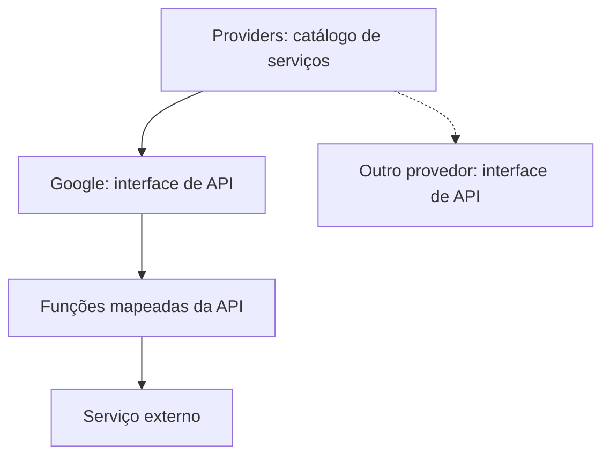

# Providers — acesso a APIs externas

## Objetivo

O módulo `providers/` é a **interface de acesso aos serviços externos** do DriveSync. Cada provedor mapeia sua API oficial para funções, tipos, requisições, respostas e erros próprios, encapsulando HTTP, endpoints, protocolos, formatos e particularidades técnicas. Para obter a API de um serviço, utiliza-se o catálogo de Providers.

**O módulo fornece acesso; não determina o uso desse acesso.** Não define fluxos de trabalho, políticas, persistência de estado da aplicação nem contratos funcionais de outras partes do software.

## Estrutura documental

```text
providers/
├── README.md
├── INTERFACES.md
├── TESTS.md
├── AGENTS.md
└── google/
    ├── README.md
    ├── INTERFACES.md
    ├── TESTS.md
    ├── AGENTS.md
    └── api/
        ├── README.md
        ├── INTERFACES.md
        ├── TESTS.md
        └── AGENTS.md
```

- `providers/`: catálogo dos provedores disponíveis e obtenção de sua interface específica.
- `providers/google/`: disponibilização da interface Google já mapeada.
- `providers/google/api/`: documentação **autoritativa** das funções, tipos e contratos técnicos da API Google.

## Funcionamento



A seleção de um provedor retorna a **interface específica** do serviço. Não há exigência de um conjunto universal de métodos compartilhados: cada serviço possui suas operações e características. Um segundo provedor só passa a integrar a lista quando sua implementação estiver realmente disponível.

## Credenciais e autenticação

A API de um serviço pode expor funções para iniciar autenticação, trocar códigos, renovar tokens, identificar usuários ou realizar requisições autenticadas, **conforme os protocolos que ela efetivamente oferece**. Providers abstrai essas chamadas técnicas.

**Providers não é proprietário de contas, tokens, armazenamento de credenciais, keyring nem políticas de sessão da aplicação.** Quando uma chamada necessitar de credenciais ou contexto autenticado, isso é expresso pelo contrato da API específica. O módulo processa os dados necessários à requisição, sem impor onde sejam guardados.

## Limites

- Não construir uma API universal de arquivos, autenticação, upload, download ou detecção.
- Não criar decisões de negócio nem determinar quando ou por que uma função externa será chamada.
- Não converter funções externas em regras de sincronização.
- Não armazenar estados funcionais alheios à integração com o serviço.
- Não duplicar funções já especificadas dentro da API de um provedor.
- Não alegar suporte a serviços ainda não implementados.

**Estado:** documentação de arquitetura-alvo; não constitui evidência de código Rust existente.

[INTERFACES](INTERFACES.md) · [TESTS](TESTS.md) · [AGENTS](AGENTS.md) · [Google](google/README.md)
