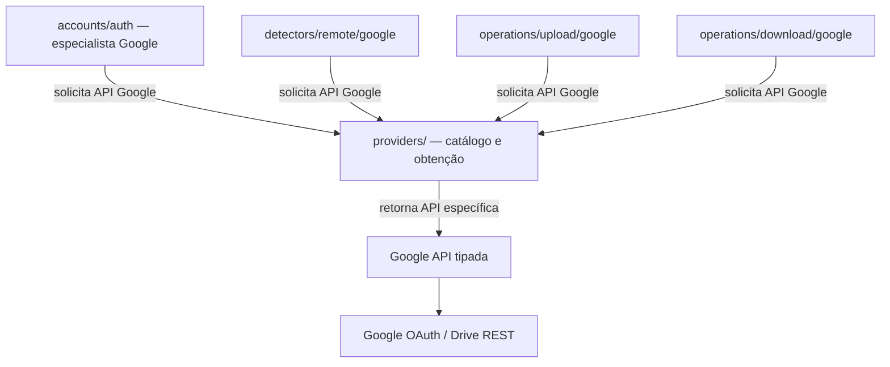
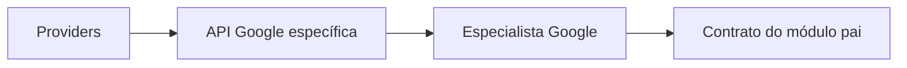

# Providers — catálogo e fábrica de APIs externas

## Responsabilidade

`providers/` é a **porta única de obtenção de APIs de serviços externos** da engine. O módulo mantém o catálogo de provedores realmente disponíveis, permite selecionar um `ProviderId` e fornece **a API específica do serviço**, opcionalmente vinculada a uma conta autenticada. **Não padroniza métodos de autenticação, listagem, alterações, upload ou download entre provedores.**

A padronização funcional pertence a **cada módulo consumidor**: `accounts/auth/` define o que espera da autenticação; `detectors/remote/` define o que deve observar e emitir; `operations/upload/` e `operations/download/` definem os resultados das transferências. Os especialistas de cada módulo conhecem a API específica do provedor e traduzem seus resultados para o contrato do respectivo módulo.

## Diagrama de dependências



Apenas os clientes obtidos por `providers/` executam chamadas de protocolo ao serviço remoto. **Especialistas podem conhecer tipos e métodos específicos da API recebida**; a restrição é não criar outros clientes HTTP/OAuth independentes fora do catálogo. Interfaces dos módulos pais permanecem comuns.

## Contrato mínimo da fachada

| Operação de Providers | Responsabilidade |
| --- | --- |
| `list` | Enumerar provedores **realmente disponíveis** |
| `get` | Selecionar provedor e fornecer sua API/descritor tipado |
| `open` | Obter API do provedor vinculada a uma conta autenticada e validada |

A definição conceitual está em [INTERFACES.md](INTERFACES.md). O provedor `example/` é somente documentação e não deve ser anunciado como funcional.

## Contratos por módulo — não por API universal

| Módulo | Contrato único do módulo | Especialista |
| --- | --- | --- |
| `accounts/auth/` | Identificar/autenticar conta e controlar credenciais | Usa Google OAuth/OIDC pela API Google obtida de Providers |
| `detectors/remote/` | Observar e emitir `models::File`; manter checkpoint | Usa Google Changes e Files, sem exigir que outro serviço tenha esses endpoints |
| `operations/upload/` | Executar upload autorizado e relatar resultado verificável | Usa uploads Google apropriados |
| `operations/download/` | Executar download autorizado e relatar resultado verificável | Usa downloads Google apropriados |



`GoogleFile` e `GoogleChange` podem existir **dentro do especialista Google**; seus limites de saída são `RemoteFile`, `File`, resultados de operações ou identidade de conta, conforme o módulo pai. `models/` e `inventory/` continuam independentes de Google.

## Autenticação e sessão

`accounts/` é proprietário do cadastro; `accounts/auth/` coordena consentimento, ciclo de vida de credenciais e keyring. Providers entrega a API específica Google (incluindo operações de OAuth) e, ao abrir uma conta, fornece contexto/sessão autorizada sem expor tokens para consumidores que não precisam deles. As operações e o protocolo de autenticação são **da API específica**, não de uma trait `ProviderAuthentication` obrigatória para todos os serviços.

A seleção é feita por `ProviderId`, a conta por `AccountId`; duas contas Google não compartilham sessões por acidente. A API pode ser reutilizada por especialistas de capacidades distintas, sob o contexto da conta correto.

## Organização documental

```text
providers/
├── README.md
├── INTERFACES.md
├── TESTS.md
├── AGENTS.md
├── google/
│   ├── README.md
│   └── api/          # Contratos específicos Google Drive/OAuth/OIDC
└── example/          # Placeholder, não funcional
```

A [API Google](google/api/INTERFACES.md) permanece específica e completa, sem forçar um mínimo comum de 59 métodos para outros serviços.

## Limites e estado

Providers **não** detecta alterações, não decide conflitos, não persiste eventos `File` ou checkpoints, não executa a fila `SyncOperation` nem administra o Inventário. É exclusivamente a entrada para obter clientes de serviços externos com identidade/sessão corretas.

**Estado:** contrato arquitetural documental proposto, não afirma implementação Rust. A forma tipada de retorno de diferentes APIs (`enum`, handle genérico ou factory tipada), o ciclo de sessão e regras de segurança serão refinados antes de código.
