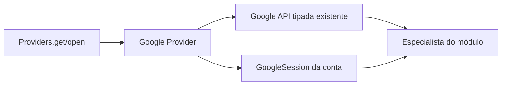

# Google Provider — INTERFACES: composição da API Google

> **Contrato interno de composição, proposto e não compilado.** Esta especificação **não substitui** nem redefine [`api/INTERFACES.md`](api/INTERFACES.md), proprietário de todos os métodos e modelos técnicos Google.

## 1. Escopo

A fachada [Providers](../INTERFACES.md) escolhe o serviço. `providers/google/` fornece dois acessos: **API Google sem conta** para operações permitidas de preparação/autenticação, e **API Google com sessão de conta** para recursos autenticados. Ambos apontam para a interface Google já definida em `api/`.



## 2. Portas internas de composição — não uma nova API Google

```rust
// Esboço de responsabilidades para orientar composição Rust.
// Não são novos métodos REST e não estão implementados.
pub(crate) trait GoogleProviderFactory {
    fn api(&self) -> GoogleApiHandle;
    fn open_account(&self, context: AuthorizedGoogleAccount)
        -> Result<GoogleAccountApiHandle, GoogleProviderError>;
}

// Representações opacas com referência à API técnica de api/.
// API e sessão são componentes distintos, mesmo se agrupados num handle.
pub(crate) struct GoogleApiHandle {
    // Acesso seguro à interface específica Google (contrato api/INTERFACES.md).
}
pub(crate) struct AuthorizedGoogleAccount {
    // Identidade AccountId e autorização resolvida por accounts/auth.
}
pub(crate) struct GoogleAccountApiHandle {
    // API Google + GoogleSession vinculada à conta autorizada.
}
```

**Observação:** `GoogleApiHandle` e `GoogleAccountApiHandle` já aparecem como **nomes conceituais** em [Providers — INTERFACES](../INTERFACES.md). Esta seção apenas organiza sua responsabilidade no módulo Google; a implementação deve definir cada tipo **uma única vez**, sem duplicar declarações em arquivos Rust diferentes. `AuthorizedGoogleAccount` é uma posição de contrato a ser definida na composição com Accounts, **não** um mecanismo aprovado de transporte de tokens.

## 3. Regras da API exposta

| Operação de catálogo | Retorno Google | Uso permitido |
| --- | --- | --- |
| `get(ProviderId("google"))` | `ProviderHandle::Google(GoogleApiHandle)` | Configuração e operações da API que não exigem `GoogleSession` |
| `open(AccountId)` | `ProviderSession::Google(GoogleAccountApiHandle)` | Recursos autenticados da API Google **para aquela conta** |

A interface técnica Google permanece como especificada em [`api/INTERFACES.md`](api/INTERFACES.md): 59 operações dos 13 recursos REST Drive v3, 9 operações de OAuth/OIDC e 10 operações de transferência/conveniência. Tipos como `GoogleSession`, `GoogleFile`, `GoogleChange`, `GoogleFileWrite` e `GoogleApiFailure` continuam a pertencer exclusivamente ao contrato `api/`.

**Não introduzir** em `providers/google/` funções que reproduzam os 78 métodos. O especialista deve usar diretamente a API tipada obtida (método específico como `changes_list`) em vez de uma falsa API `RemoteApi` universal.

## 4. Exemplo de consumo pelo especialista de Detector

```rust
// Pseudocódigo: tipo de handle e lifetime ainda não definidos.
let google = match providers.open(account_id)? {
    ProviderSession::Google(handle) => handle,
};
let page = google.api().changes_list(google.session(), options)?;
let observation = specialist.interpret_google_change(page);
// specialist emite models::File pelo contrato RemoteDetector.
```

O exemplo mostra **o sentido da dependência**; `api()`, `session()` e `interpret_google_change` não constituem assinaturas Rust aprovadas. `GoogleChange` pode existir no especialista; o Detector pai recebe apenas o contrato comum (`File`, `RemotePollResult`, `RemoteEventSink`).

## 5. Autenticação e proteção dos dados

- `accounts/auth/` coordena consentimento, callback, credenciais em Secret Service/keyring, renovação e sessão.
- `providers/google/api/` fornece a implementação do protocolo OAuth/OIDC, cujos métodos técnicos já estão no contrato existente.
- `providers/google/` liga API e contexto autenticado sem cadastrar contas, manipular `inventory.sqlite3` ou escolher arquivos para sincronização.
- Nunca exportar access/refresh token por `ProviderHandle` ou por APIs de módulo pai; a representação concreta do segredo deve ser revisada antes do Rust.
- Reautorização/revogação precisa invalidar handles com autorização obsoleta, sem fallback silencioso para outra conta.

## 6. Fora do escopo

`providers/google/` não decide polling, não confirma checkpoint, não guarda `FileBatch`, não interpreta baseline, não determina uploads, não define fila de operações e não implementa o registro do Inventário. Tudo isso é responsabilidade dos módulos consumidores.

## 7. Pendências

A representação de `GoogleApiHandle` e `GoogleAccountApiHandle`, `&self`, `async`, compartilhamento de cliente HTTP, gestão de sessão e autorização injetada exigem revisão antes da implementação. Não inventar uma migração ou uma segunda interface técnica para contornar essa definição.
