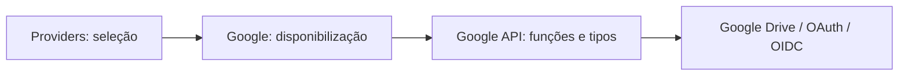

# Google — disponibilização da API Google

## Objetivo

`providers/google/` disponibiliza a interface específica do Google já mapeada em [`api/`](api/README.md), por meio do catálogo de Providers. **Não implementa segunda API nem determina o uso de suas funções.**

A pasta `api/` continua sendo a **fonte de verdade** para métodos, tipos, parâmetros, respostas e erros de Google Drive REST v3, OAuth 2.0, OpenID Connect e transferências.

## Organização

```text
google/
├── README.md                 # Responsabilidade e composição
├── INTERFACES.md             # Como disponibilizar a API específica
├── TESTS.md                  # Testes de obtenção/inicialização
├── AGENTS.md                 # Regras locais
└── api/
    ├── README.md             # Mapeamento técnico da API
    ├── INTERFACES.md         # Funções, argumentos e tipos
    ├── TESTS.md              # Testes dos métodos técnicos
    └── AGENTS.md             # Instruções da API Google
```

## Limite entre Google e Google API



| Parte | Responsabilidade |
| --- | --- |
| `providers/` | Localizar e entregar a interface do serviço solicitado |
| `providers/google/` | Configurar e disponibilizar a implementação Google |
| `providers/google/api/` | Encapsular protocolos, parâmetros, endpoints, respostas e erros Google |

`google/` não redefine `GoogleFile`, `GoogleSession`, `GoogleApiFailure` ou os métodos do cliente. Fornecer acesso à API é diferente de implementar um novo contrato funcional.

## Autenticação

A API Google já documenta operações técnicas de OAuth/OIDC e sessões autenticadas. Essas funções continuam disponíveis **como parte da interface Google**. Este módulo não registra contas, não guarda tokens e não determina o ciclo de vida das credenciais. Dados necessários a uma chamada são recebidos pelos contratos específicos da API.

## Contratos já definidos

- **59** métodos dos recursos REST da Google Drive API v3.
- **9** métodos de OAuth 2.0 e OpenID Connect.
- **10** métodos adicionais de transferências e conveniências.

O conjunto técnico permanece definido em [Google API — INTERFACES](api/INTERFACES.md), sem reescrita ou cópia.

## Estado

Organização documental proposta. Não descreve uma implementação Rust já verificada.

[INTERFACES](INTERFACES.md) · [TESTS](TESTS.md) · [AGENTS](AGENTS.md) · [Google API](api/README.md)
