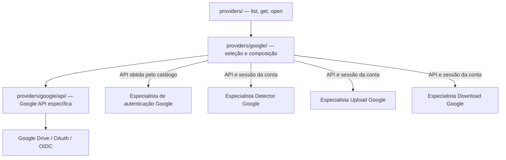

# Google Provider — composição e exposição da API específica

> **Estado:** organização documental e contratos de integração propostos. Não corresponde necessariamente à estrutura Rust implementada.

## 1. Responsabilidade do módulo

`providers/google/` é a **implementação específica Google** que a fábrica [Providers](../INTERFACES.md) seleciona. Sua responsabilidade é **disponibilizar, de maneira tipada e segura, a API Google já contratada** em [`api/INTERFACES.md`](api/INTERFACES.md), incluindo cliente e contexto autenticado por conta.

**Não** define uma segunda API de Files, Changes, OAuth, upload ou download; essas operações já têm contratos técnicos dentro de `api/`. **Não** implementa as decisões de Detector, Accounts, Upload, Download ou Analisador.

## 2. Organização

```text
providers/
├── README.md                # Catálogo/fábrica genérica
├── INTERFACES.md            # list / get / open (contrato conceitual)
└── google/
    ├── README.md            # Composição e fronteiras Google
    ├── INTERFACES.md        # Handles tipados / ligação com Providers
    ├── TESTS.md             # Testes de seleção, sessão e delegação
    ├── AGENTS.md            # Regras para implementação do módulo Google
    └── api/
        ├── README.md        # Comportamento e recursos Google
        ├── INTERFACES.md    # 59 REST + 9 OAuth/OIDC + 10 auxiliares
        ├── TESTS.md         # Testes dos 78 métodos técnicos
        └── AGENTS.md        # Instruções para o cliente Google
```

**Separação:** `google/` é composição/exposição **da API existente**; `google/api/` é a API específica Google com seus métodos, estruturas e tratamento de protocolo. Não duplicar os 78 contratos no nível `google/`.

## 3. Fluxo de dependências



A fábrica `providers/` é o ponto de obtenção. Os especialistas podem **conhecer métodos e tipos específicos** da API Google que receberam; não constroem um cliente HTTP independente.

## 4. Dois acessos distintos

| Acesso pelo catálogo | Uso | Limite |
| --- | --- | --- |
| `Providers.get(google)` | Obter a API Google **sem sessão autenticada** para iniciar procedimentos como configuração/consentimento OAuth | Não acessa arquivos de uma conta |
| `Providers.open(account_id)` | Obter a API Google **associada à conta correta**, com sessão autorizada | Não retorna token em texto nem utiliza conta de terceiros |

O catálogo não autentica por conta própria nem persiste conta ou tokens. `accounts/auth/` é responsável pela gestão do processo de autenticação e keyring. A API Google executa as requisições OAuth/OIDC conforme seus próprios métodos. Um handle de sessão não deve permanecer autorizado após revogação.

## 5. Quem recebe quais operações Google?

| Especialista consumidor | Recursos da API específica que pode utilizar | Contrato que precisa cumprir |
| --- | --- | --- |
| Accounts/Auth Google | `load_google_config`, `authorization_request`, `exchange_authorization_code`, `refresh_access_token` e OIDC | Resultado de autenticação definido por Accounts/Auth |
| Detector Remoto Google | `changes_*`, `files_*`, paginação e metadados | `RemoteDetector`: `File`, estado, checkpoint do Detector |
| Upload Google | `files_create`, `files_update`, rotinas de upload resumable | Contrato funcional do módulo Upload, quando definido |
| Download Google | `files_get`, `files_export` e rotinas de download | Contrato funcional do módulo Download, quando definido |

Esta tabela é **orientativa**, não inventário exaustivo de métodos permitidos. Cada especialista usa os recursos de que precisar. Pode traduzir `GoogleFile/GoogleChange` para `RemoteFile/File`, mas **a obrigação de normalização está na fronteira do módulo pai**, não no catálogo.

## 6. Regras de encapsulamento

1. A fábrica valida `ProviderId=google` e vínculo de `AccountId` antes de entregar um handle autenticado.
2. `providers/google/` não guarda a conta em banco próprio, não administra keyring e não substitui `accounts/auth/`.
3. `providers/google/api/` mantém seu contrato completo e sua própria cobertura de testes; não depende de Detector/Upload/Download.
4. Especialistas podem usar tipos Google dentro de sua implementação, **sem expô-los nas interfaces genéricas** de Detector, Accounts, Upload ou Download.
5. O checkpoint e a fila de eventos pertencem a Detector; o Inventário permanece independente de Google.
6. `get` e `open` devem falhar explicitamente em seleção, sessão ou autorização inválidas.
7. Não criar novas traits universais de protocolo nem wrappers `get_file`/`list_changes` duplicados em `google/`.

## 7. Documentos de referência

- [Google — INTERFACES](INTERFACES.md): contrato de composição e exposição tipada.
- [Google — TESTS](TESTS.md): verificação da fábrica, das sessões e da delegação.
- [Google — AGENTS](AGENTS.md): regras específicas de implementação.
- [Google API — INTERFACES](api/INTERFACES.md): **fonte de verdade dos métodos técnicos e dos tipos Google**.
- [Google API — TESTS](api/TESTS.md): **fonte de verdade dos testes por método técnico**.

**Pendência de implementação:** definir a materialização dos handles Rust, ownership e autenticação entre Accounts e Providers sem circularidade. Nenhuma assinatura técnica de `api/` é alterada por esta organização.
