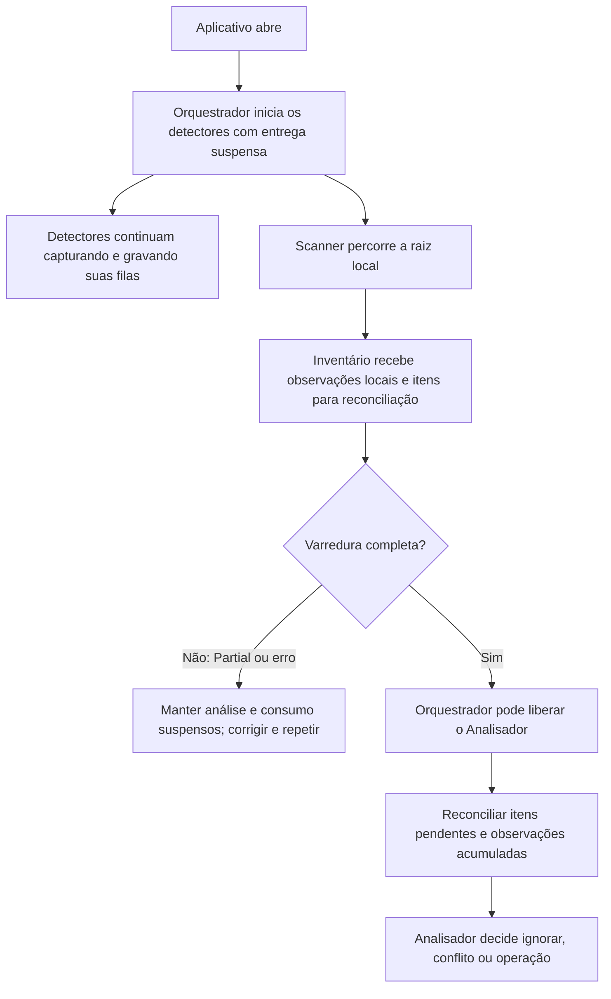

# Scanner Local — implementação

## Fluxo validado com o usuário



A escolha explícita do usuário mantém o Analisador suspenso após varredura
parcial. Conclusão é cobertura e persistência suficientes, não ausência de todo
problema individual nem identidade de conteúdo comprovada por metadados.
O Scanner não libera filas nem chama Analisador. `report.ready_for_analysis()`
é somente a expressão dessa condição para a coordenação.

A fila do Detector contém observações; a fila de operações do Inventário contém
intenções definidas posteriormente. Eventos capturados antes/durante a varredura
podem ser entregues depois dela: a futura ingestão precisa reobservar/revalidar o
item, sem sobrepor o estado recém-varrido com metadados antigos só porque a
ocorrência foi consumida por último. Revisão não é ordem temporal do filesystem.

## Implementação compilada

`engine/src/scanner/` implementa `new`, `scan` assíncrono e `status`. ScannerConfig
recebe Arc<InventoryManager> e LocalRoot. GetSyncInfoResult agora informa os bytes
da raiz absoluta armazenada: essa extensão pequena e explícita é necessária
para validar o vínculo exato, além do SyncId, sem SQLite dentro do Scanner.
Não houve alteração de esquema, migração ou compatibilidade legada.

Cada chamada efetiva de scan cria um único worker bloqueante de duração finita,
sem runtime Tokio obrigatório no chamador ou worker permanente próprio. O future
aguarda um oneshot compatível com qualquer executor. Dropar o future solicita
cancelamento cooperativo; commits anteriores são preservados. Cancelamento não
cria um relatório Completed. Não foi acrescentado método cancel/pause.

Status usa mutex curto separado de I/O, com contagens observadas e aceitas. Uma
segunda varredura na mesma instância retorna AlreadyRunning. A próxima execução
reinicializa os contadores/erro. Raiz conta como diretório, mas não vira SyncItem:
LocalRelativePath representa somente entradas abaixo dela. Arquivos conta
regulares observados; links/especiais têm metadados, mas não são arquivos regulares.

## Observações e pendências

A entrada existente é localizada pelo vínculo de caminho já armazenado. Isso
preserva o SyncItem lógico; não prova identidade física persistente nem renomeação.
Não são gerados LocalFileId, não há associação por nome e não se pesquisa por
inode para inferir movimentos. Uma localização nova gera novo item; o Analisador
futuramente poderá decidir associação com evidência suficiente.

Revisão é lida antes da coleta e exigida na gravação. O envelope é uma observação
RecheckRequired/UnclassifiedSignal, com prova LocalScan e identificador aleatório
por execução: não inventa sinal nativo nem classifica criação/edição/exclusão.
Metadados são coletados sem conteúdo/hash e usam a mesma projeção Linux privada
do coletor do Detector, sem dependência operacional entre Scanner e Detector.

Toda observação local aceita fica PendingReconciliation, inclusive itens antes
Synced. O Scanner não prova igualdade de conteúdo e não promete filtrar somente
mudanças com metadados. A marca é persistente e consultável por ItemFilter.statuses;
continua disponível depois de reabrir o banco. O Analisador decidirá o que mudou.

record_local e eventual update_item_status usam a revisão esperada. São duas
transações: uma falha entre elas torna a varredura Partial/erro, impedindo a
liberação. Na inicialização seguinte é necessário varrer de novo; não existe
marcador durável de varredura completa que dispense essa etapa.

## Cobertura e segurança

Percurso iterativo; nomes Unix preservados em bytes; `.drivesync` é excluído em
qualquer nível. Navegação usa descritores O_PATH/O_NOFOLLOW e valida vínculos
antes/depois da coleta, além de manter a raiz e ancestralidade absoluta presas.
Links são observados pelo próprio descritor e readlinkat; seus destinos não são
percorridos. FIFOs/especiais nunca são abertos para leitura de conteúdo.

Montagens diferentes são recusadas por STATX_MNT_ID, inclusive bind mounts no
mesmo dispositivo. A ausência de uma identidade de montagem suportada não
concede permissão para atravessar a fronteira. A configuração da raiz exige
suporte Linux a essa identidade. Testes de montagem real privilegiada não foram
executados.

O Scanner guarda somente evidências por diretório, caminhos da pilha de percurso
e o relatório de problemas; não materializa o inventário inteiro. A etapa de
ausência consulta páginas de 100 itens e revalida a falta da entrada e o ancestral
mais próximo enumerado por completo. Diretório inacessível, trocado, instável,
montagem recusada ou erro de enumeração não comprova ausência dos descendentes.
Não há snapshot atômico do filesystem; os eventos acumulados cobrem mudanças
concorrentes e o consumidor precisa revalidar antes de executar efeitos.

Baseline, lado remoto, last_synced_at, operações e histórico confirmado não são
alterados. Falhas individuais produzem issues e o percurso continua; perda de
cobertura/persistência produz Partial. Falha estrutural de raiz/Inventory produz
ScannerError, sem recriar banco nem declarar ausência.

## Limites de integração

- **SC-20 / diagnóstico durável: BLOCKED.** ScanIssue ainda está no relatório e
  não existe API/tabela de diagnóstico por varredura/item no Inventory. Estados
  MetadataValue e pendências são duráveis, mas não se afirma recuperação de todo
  ScanIssue pelo Analisador. Não foi usado histórico de atividades para simular
  diagnóstico global.
- **SC-05 / identidade persistente para renomeações: BLOCKED.** O coletor ainda
  fornece local_id=None. Scanner não deduz identidade estável por nome ou inode.
- A inicialização automática do aplicativo, a coordenação completa do Orquestrador
  e o Analisador continuam uma integração posterior. O consumidor atual do
  Developer é diagnóstico terminal e confirma filas: ele não pode substituir o
  consumidor futuro nem ser retomado como se fizesse reconciliação.
- Inventory deve ser entregue ao Scanner já aberto e utilizável. Scanner não
  altera a política de provisionamento/recuperação do banco nem o inicializa.
- Não foram usados contas reais, transferência, GUI ou benchmark de 80 mil itens.

Quando um antigo diretório agora é comprovadamente um arquivo/link folha, o
Scanner pode confirmar ausência das localizações antigas abaixo dele usando o
ancestral enumerado e a revalidação do tipo atual. Isso não percorre o destino
do link nem decide exclusão física. Uma troca de diretório por link no meio do
percurso, por outro lado, invalida a cobertura daquela execução e produz Partial.

## Verificação da unidade

Executados no SDK org.gnome.Sdk//50 com rust-stable: cargo fmt --all,
cargo test -p drivesync-engine scanner::tests --lib (14 aprovados),
cargo test -p drivesync-engine --test scanner (1 aprovado) e
cargo clippy --workspace --all-targets -- -D warnings. O teste público também
reabre o banco e consulta os itens por PendingReconciliation.

## Verificação integrada final em 14/11/2026

Executados exclusivamente em org.gnome.Sdk//50 com a extensão rust-stable:

```sh
cargo fmt --all --check
cargo clippy --workspace --all-targets -- -D warnings
cargo test --workspace
cargo doc --workspace --no-deps --document-private-items
cargo test --workspace --doc
cargo build --workspace
```

Todos passaram, sem warnings. O workspace aprovou 712 testes, incluindo 6
doctests; 9 testes de ambiente existentes ficaram ignorados. A chamada explícita
--doc repetiu os 6 doctests, todos aprovados. O Scanner tem 14 testes internos e
um teste público; o último usa executor mínimo sem Tokio e reabre o banco para
consultar pendências duráveis. SC-05 e SC-20 permanecem lacunas documentadas, não
são contados como testes aprovados ou ignorados.

A revisão final verificou fronteiras (sem SQL/Detector/Provider no Scanner),
raízes/links, cobertura, paginação, revisão antes da coleta, cancelamento, ausência
de stubs e dependências novas. Não foram identificados resíduos que justificassem
um commit artificial de limpeza. A implementação está em commits locais da
branch feat/scanner, sem publicação remota.
