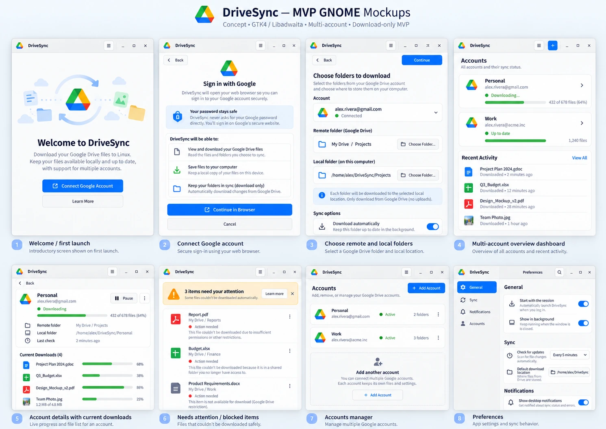

# DriveSync — Visual Concept Archive

**Status:** Concept mockups only, not screenshots of a working application. The artwork includes exploratory ideas and may differ from the MVP scope, GNOME HIG guidance or current engine contracts.

These ten images preserve the visual exploration produced on 2026-10-20. Images are stored as **high-quality WebP versions** of the generated PNGs (optimized for repository size). The original SVG wireframes in this directory remain available.

## Complete concept boards

### Latest GNOME-oriented MVP board

[Open full image](concepts/10-full-board-gnome-mvp.webp)

### Earlier full concept board

[Open initial full image](concepts/09-full-board-initial.webp)

## Individual screen explorations

| Screen | Concept image |
|---|---|
| Welcome | [01 — Welcome](concepts/01-welcome.webp) |
| Google account authorization | [02 — Account authorization](concepts/02-account-authorization.webp) |
| Choose folders | [03 — Select folders](concepts/03-select-folders.webp) |
| Multi-account dashboard | [04 — Dashboard](concepts/04-dashboard.webp) |
| Transfers and account details | [05 — Transfers](concepts/05-transfers.webp) |
| Conflicts and attention | [06 — Attention and conflicts](concepts/06-attention-conflicts.webp) |
| Preferences | [07 — Preferences](concepts/07-preferences.webp) |
| Multiple accounts management | [08 — Accounts](concepts/08-accounts.webp) |

## Design and implementation notes

The images are **historical design explorations**, not binding implementation specifications. Some images show features intentionally outside the download-only MVP, such as complete conflict resolution, native Google Workspace document transfers or multiple sync folders per account.

For the actual product scope and native widget mapping, refer to:

- [GNOME HIG and engine compatibility review](../ui-mockups.md)
- [MVP implementation plan](../MVP.md)
- [Global architecture](../architecture.md)

Do not silently erase or replace an image when the design changes; add a new dated concept and update this index to preserve the design history.
