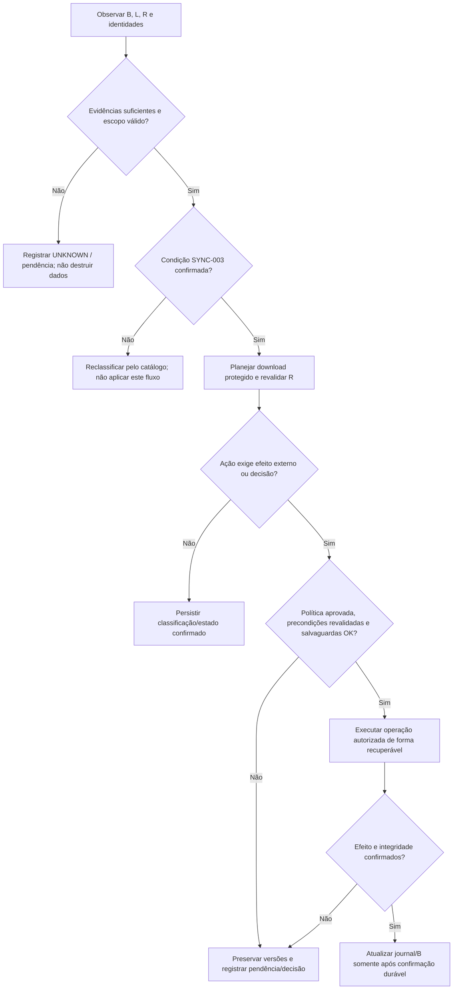
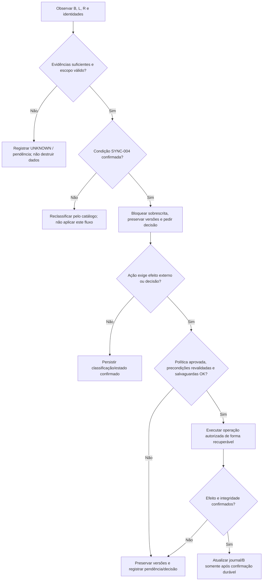
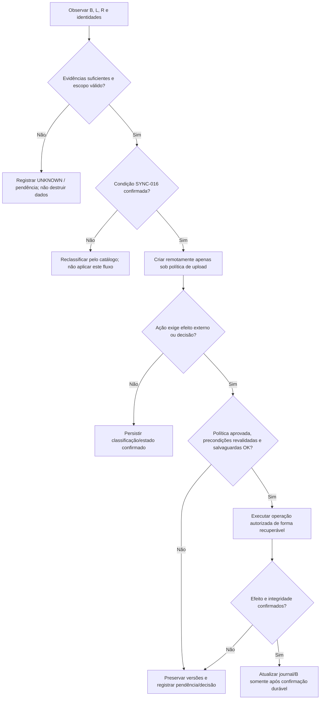
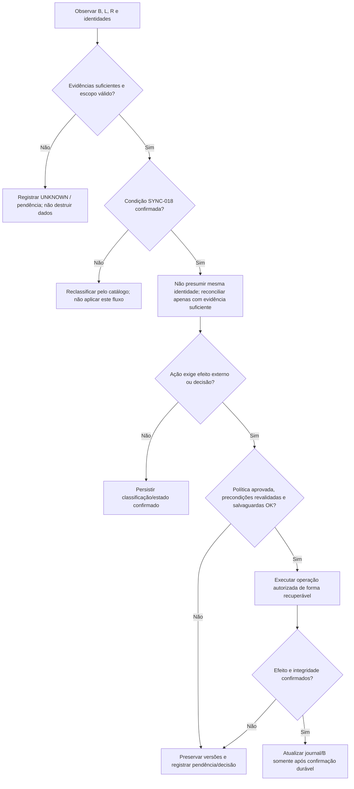
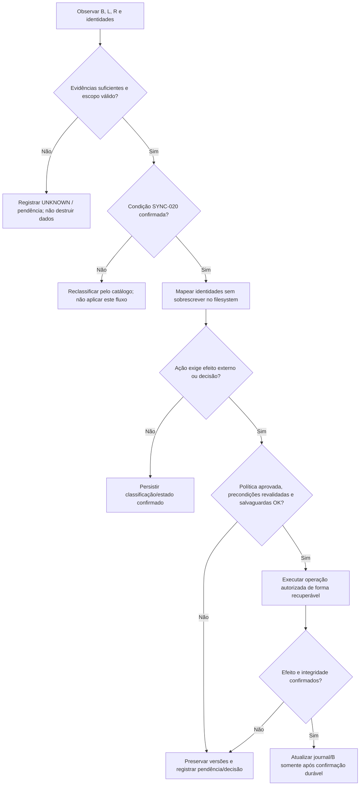

# Fluxogramas de cenários — DriveSync

> **Diagramas normativos propostos**, sujeitos a revisão contra código e testes. Nenhum diagrama declara implementação ou validação concluída. Referência: [matriz](scenarios.md). Os fluxos abaixo são intencionalmente individuais e rastreáveis; ações destrutivas ou sem executor aprovado não são autorizadas por esta documentação.

## SYNC-001 — Sem alterações

**Pré-condição:** B confirmado; L e R iguais ao estado-base. **Saída pretendida:** Não transferir; conservar B.


## SYNC-002 — Somente local modificado

**Pré-condição:** B confirmado; L mudou, R não. **Saída pretendida:** Planejar upload apenas se autorizado e com precondição remota.


## SYNC-003 — Somente remoto modificado

**Pré-condição:** B confirmado; R mudou, L não. **Saída pretendida:** Planejar download protegido e revalidar R.



## SYNC-004 — Ambos modificados, divergentes

**Pré-condição:** B confirmado; conteúdos diferentes. **Saída pretendida:** Bloquear sobrescrita, preservar versões e pedir decisão.



## SYNC-005 — Ambos modificados, equivalentes

**Pré-condição:** B confirmado; conteúdos equivalentes com evidência forte. **Saída pretendida:** Reconciliar sem duplicar e confirmar B.


## SYNC-006 — Local excluído, remoto intacto

**Pré-condição:** B confirmado; ausência local comprovada. **Saída pretendida:** Suspender exclusão remota até autorização específica.


## SYNC-007 — Local intacto, remoto excluído

**Pré-condição:** B confirmado; exclusão remota comprovada. **Saída pretendida:** Preservar local e aplicar política de exclusão autorizada.


## SYNC-008 — Local excluído, remoto modificado

**Pré-condição:** B confirmado; R alterado. **Saída pretendida:** Preservar R e solicitar resolução.


## SYNC-009 — Local modificado, remoto excluído

**Pré-condição:** B confirmado; L alterado. **Saída pretendida:** Preservar L e solicitar resolução.


## SYNC-010 — Ambos excluídos

**Pré-condição:** B confirmado; duas ausências comprovadas. **Saída pretendida:** Registrar convergência sem nova exclusão.


## SYNC-011 — Edição e renomeação locais

**Pré-condição:** Identidade mantida; R sem mudanças. **Saída pretendida:** Validar destino e planejar operações autorizadas.


## SYNC-012 — Edição e renomeação remotas

**Pré-condição:** Identidade mantida; L sem mudanças. **Saída pretendida:** Validar nome/destino e receber alterações seguras.


## SYNC-013 — Renomeações divergentes

**Pré-condição:** Mesmo ID, nomes diferentes. **Saída pretendida:** Bloquear escolha arbitrária e solicitar resolução.


## SYNC-014 — Edição local e renomeação remota

**Pré-condição:** Operações independentes e identidades comprovadas. **Saída pretendida:** Combinar somente se seguro; senão pendência.


## SYNC-015 — Renomeação local e edição remota

**Pré-condição:** Operações independentes e identidades comprovadas. **Saída pretendida:** Combinar somente se seguro; senão pendência.


## SYNC-016 — Novo local, remoto ausente

**Pré-condição:** Sem B; ausência remota comprovada. **Saída pretendida:** Criar remotamente apenas sob política de upload.



## SYNC-017 — Novo remoto, local ausente

**Pré-condição:** Sem B; ausência local comprovada. **Saída pretendida:** Baixar sem sobrescrever arquivo preexistente.


## SYNC-018 — Criações simultâneas equivalentes

**Pré-condição:** Sem B; dois objetos e mesmo nome/conteúdo. **Saída pretendida:** Não presumir mesma identidade; reconciliar apenas com evidência suficiente.



## SYNC-019 — Criações simultâneas divergentes

**Pré-condição:** Sem B; mesmos nomes, bytes diferentes. **Saída pretendida:** Preservar dois objetos e bloquear colisão.


## SYNC-020 — Nomes remotos duplicados

**Pré-condição:** Dois IDs remotos sob mesmo pai e nome. **Saída pretendida:** Mapear identidades sem sobrescrever no filesystem.



## SYNC-021 — Arquivo versus pasta

**Pré-condição:** Tipos diferentes ocupam mesmo caminho. **Saída pretendida:** Bloquear e informar incompatibilidade.

```mermaid
flowchart TD
    A["Observar B, L, R e identidades"] --> B{"Evidências suficientes e escopo válido?"}
    B -->|Não| U["Registrar UNKNOWN / pendência; não destruir dados"]
    B -->|Sim| C{"Condição SYNC-021 confirmada?"}
    C -->|Não| X["Reclassificar pelo catálogo; não aplicar este fluxo"]
    C -->|Sim| D["Bloquear e informar incompatibilidade"]
    D --> E{"Ação exige efeito externo ou decisão?"}
    E -->|Não| F["Persistir classificação/estado confirmado"]
    E -->|Sim| G{"Política aprovada, precondições revalidadas e salvaguardas OK?"}
    G -->|Não| H["Preservar versões e registrar pendência/decisão"]
    G -->|Sim| I["Executar operação autorizada de forma recuperável"]
    I --> J{"Efeito e integridade confirmados?"}
    J -->|Não| H
    J -->|Sim| K["Atualizar journal/B somente após confirmação durável"]
```

## SYNC-022 — Recriação após exclusão

**Pré-condição:** Nova identidade surge após tombstone. **Saída pretendida:** Tratar como nova criação; não herdar B pelo nome.

```mermaid
flowchart TD
    A["Observar B, L, R e identidades"] --> B{"Evidências suficientes e escopo válido?"}
    B -->|Não| U["Registrar UNKNOWN / pendência; não destruir dados"]
    B -->|Sim| C{"Condição SYNC-022 confirmada?"}
    C -->|Não| X["Reclassificar pelo catálogo; não aplicar este fluxo"]
    C -->|Sim| D["Tratar como nova criação; não herdar B pelo nome"]
    D --> E{"Ação exige efeito externo ou decisão?"}
    E -->|Não| F["Persistir classificação/estado confirmado"]
    E -->|Sim| G{"Política aprovada, precondições revalidadas e salvaguardas OK?"}
    G -->|Não| H["Preservar versões e registrar pendência/decisão"]
    G -->|Sim| I["Executar operação autorizada de forma recuperável"]
    I --> J{"Efeito e integridade confirmados?"}
    J -->|Não| H
    J -->|Sim| K["Atualizar journal/B somente após confirmação durável"]
```

## SYNC-023 — Movimentações concorrentes

**Pré-condição:** Mesmo item movido para destinos diferentes. **Saída pretendida:** Comparar IDs e pais; bloquear destinos incompatíveis.

```mermaid
flowchart TD
    A["Observar B, L, R e identidades"] --> B{"Evidências suficientes e escopo válido?"}
    B -->|Não| U["Registrar UNKNOWN / pendência; não destruir dados"]
    B -->|Sim| C{"Condição SYNC-023 confirmada?"}
    C -->|Não| X["Reclassificar pelo catálogo; não aplicar este fluxo"]
    C -->|Sim| D["Comparar IDs e pais; bloquear destinos incompatíveis"]
    D --> E{"Ação exige efeito externo ou decisão?"}
    E -->|Não| F["Persistir classificação/estado confirmado"]
    E -->|Sim| G{"Política aprovada, precondições revalidadas e salvaguardas OK?"}
    G -->|Não| H["Preservar versões e registrar pendência/decisão"]
    G -->|Sim| I["Executar operação autorizada de forma recuperável"]
    I --> J{"Efeito e integridade confirmados?"}
    J -->|Não| H
    J -->|Sim| K["Atualizar journal/B somente após confirmação durável"]
```

## SYNC-024 — Renomeação de pasta e edições descendentes

**Pré-condição:** Alterações de árvore e descendentes. **Saída pretendida:** Reconstruir dependências antes de mover ou atualizar.

```mermaid
flowchart TD
    A["Observar B, L, R e identidades"] --> B{"Evidências suficientes e escopo válido?"}
    B -->|Não| U["Registrar UNKNOWN / pendência; não destruir dados"]
    B -->|Sim| C{"Condição SYNC-024 confirmada?"}
    C -->|Não| X["Reclassificar pelo catálogo; não aplicar este fluxo"]
    C -->|Sim| D["Reconstruir dependências antes de mover ou atualizar"]
    D --> E{"Ação exige efeito externo ou decisão?"}
    E -->|Não| F["Persistir classificação/estado confirmado"]
    E -->|Sim| G{"Política aprovada, precondições revalidadas e salvaguardas OK?"}
    G -->|Não| H["Preservar versões e registrar pendência/decisão"]
    G -->|Sim| I["Executar operação autorizada de forma recuperável"]
    I --> J{"Efeito e integridade confirmados?"}
    J -->|Não| H
    J -->|Sim| K["Atualizar journal/B somente após confirmação durável"]
```

## SYNC-025 — Offline sem mudança local

**Pré-condição:** Sem acesso remoto. **Saída pretendida:** Aguardar sem inferir estado remoto.

```mermaid
flowchart TD
    A["Observar B, L, R e identidades"] --> B{"Evidências suficientes e escopo válido?"}
    B -->|Não| U["Registrar UNKNOWN / pendência; não destruir dados"]
    B -->|Sim| C{"Condição SYNC-025 confirmada?"}
    C -->|Não| X["Reclassificar pelo catálogo; não aplicar este fluxo"]
    C -->|Sim| D["Aguardar sem inferir estado remoto"]
    D --> E{"Ação exige efeito externo ou decisão?"}
    E -->|Não| F["Persistir classificação/estado confirmado"]
    E -->|Sim| G{"Política aprovada, precondições revalidadas e salvaguardas OK?"}
    G -->|Não| H["Preservar versões e registrar pendência/decisão"]
    G -->|Sim| I["Executar operação autorizada de forma recuperável"]
    I --> J{"Efeito e integridade confirmados?"}
    J -->|Não| H
    J -->|Sim| K["Atualizar journal/B somente após confirmação durável"]
```

## SYNC-026 — Offline com edição local

**Pré-condição:** Mudança local observada; R desconhecido. **Saída pretendida:** Registrar pendência, sem upload até revalidar.

```mermaid
flowchart TD
    A["Observar B, L, R e identidades"] --> B{"Evidências suficientes e escopo válido?"}
    B -->|Não| U["Registrar UNKNOWN / pendência; não destruir dados"]
    B -->|Sim| C{"Condição SYNC-026 confirmada?"}
    C -->|Não| X["Reclassificar pelo catálogo; não aplicar este fluxo"]
    C -->|Sim| D["Registrar pendência, sem upload até revalidar"]
    D --> E{"Ação exige efeito externo ou decisão?"}
    E -->|Não| F["Persistir classificação/estado confirmado"]
    E -->|Sim| G{"Política aprovada, precondições revalidadas e salvaguardas OK?"}
    G -->|Não| H["Preservar versões e registrar pendência/decisão"]
    G -->|Sim| I["Executar operação autorizada de forma recuperável"]
    I --> J{"Efeito e integridade confirmados?"}
    J -->|Não| H
    J -->|Sim| K["Atualizar journal/B somente após confirmação durável"]
```

## SYNC-027 — Offline com criação local

**Pré-condição:** Novo L, R desconhecido. **Saída pretendida:** Registrar intenção e reavaliar ao reconectar.

```mermaid
flowchart TD
    A["Observar B, L, R e identidades"] --> B{"Evidências suficientes e escopo válido?"}
    B -->|Não| U["Registrar UNKNOWN / pendência; não destruir dados"]
    B -->|Sim| C{"Condição SYNC-027 confirmada?"}
    C -->|Não| X["Reclassificar pelo catálogo; não aplicar este fluxo"]
    C -->|Sim| D["Registrar intenção e reavaliar ao reconectar"]
    D --> E{"Ação exige efeito externo ou decisão?"}
    E -->|Não| F["Persistir classificação/estado confirmado"]
    E -->|Sim| G{"Política aprovada, precondições revalidadas e salvaguardas OK?"}
    G -->|Não| H["Preservar versões e registrar pendência/decisão"]
    G -->|Sim| I["Executar operação autorizada de forma recuperável"]
    I --> J{"Efeito e integridade confirmados?"}
    J -->|Não| H
    J -->|Sim| K["Atualizar journal/B somente após confirmação durável"]
```

## SYNC-028 — Offline com exclusão local

**Pré-condição:** Ausência L, R desconhecido. **Saída pretendida:** Registrar intenção; nenhuma exclusão remota.

```mermaid
flowchart TD
    A["Observar B, L, R e identidades"] --> B{"Evidências suficientes e escopo válido?"}
    B -->|Não| U["Registrar UNKNOWN / pendência; não destruir dados"]
    B -->|Sim| C{"Condição SYNC-028 confirmada?"}
    C -->|Não| X["Reclassificar pelo catálogo; não aplicar este fluxo"]
    C -->|Sim| D["Registrar intenção; nenhuma exclusão remota"]
    D --> E{"Ação exige efeito externo ou decisão?"}
    E -->|Não| F["Persistir classificação/estado confirmado"]
    E -->|Sim| G{"Política aprovada, precondições revalidadas e salvaguardas OK?"}
    G -->|Não| H["Preservar versões e registrar pendência/decisão"]
    G -->|Sim| I["Executar operação autorizada de forma recuperável"]
    I --> J{"Efeito e integridade confirmados?"}
    J -->|Não| H
    J -->|Sim| K["Atualizar journal/B somente após confirmação durável"]
```

## SYNC-029 — Reconexão; só local mudou

**Pré-condição:** R consultado e igual a B. **Saída pretendida:** Planejar envio conforme política, revalidando.

```mermaid
flowchart TD
    A["Observar B, L, R e identidades"] --> B{"Evidências suficientes e escopo válido?"}
    B -->|Não| U["Registrar UNKNOWN / pendência; não destruir dados"]
    B -->|Sim| C{"Condição SYNC-029 confirmada?"}
    C -->|Não| X["Reclassificar pelo catálogo; não aplicar este fluxo"]
    C -->|Sim| D["Planejar envio conforme política, revalidando"]
    D --> E{"Ação exige efeito externo ou decisão?"}
    E -->|Não| F["Persistir classificação/estado confirmado"]
    E -->|Sim| G{"Política aprovada, precondições revalidadas e salvaguardas OK?"}
    G -->|Não| H["Preservar versões e registrar pendência/decisão"]
    G -->|Sim| I["Executar operação autorizada de forma recuperável"]
    I --> J{"Efeito e integridade confirmados?"}
    J -->|Não| H
    J -->|Sim| K["Atualizar journal/B somente após confirmação durável"]
```

## SYNC-030 — Reconexão; só remoto mudou

**Pré-condição:** L igual a B, R diferente. **Saída pretendida:** Planejar download seguro.

```mermaid
flowchart TD
    A["Observar B, L, R e identidades"] --> B{"Evidências suficientes e escopo válido?"}
    B -->|Não| U["Registrar UNKNOWN / pendência; não destruir dados"]
    B -->|Sim| C{"Condição SYNC-030 confirmada?"}
    C -->|Não| X["Reclassificar pelo catálogo; não aplicar este fluxo"]
    C -->|Sim| D["Planejar download seguro"]
    D --> E{"Ação exige efeito externo ou decisão?"}
    E -->|Não| F["Persistir classificação/estado confirmado"]
    E -->|Sim| G{"Política aprovada, precondições revalidadas e salvaguardas OK?"}
    G -->|Não| H["Preservar versões e registrar pendência/decisão"]
    G -->|Sim| I["Executar operação autorizada de forma recuperável"]
    I --> J{"Efeito e integridade confirmados?"}
    J -->|Não| H
    J -->|Sim| K["Atualizar journal/B somente após confirmação durável"]
```

## SYNC-031 — Reconexão; ambos mudaram

**Pré-condição:** L e R diferem de B. **Saída pretendida:** Classificar divergência ou equivalência; preservar.

```mermaid
flowchart TD
    A["Observar B, L, R e identidades"] --> B{"Evidências suficientes e escopo válido?"}
    B -->|Não| U["Registrar UNKNOWN / pendência; não destruir dados"]
    B -->|Sim| C{"Condição SYNC-031 confirmada?"}
    C -->|Não| X["Reclassificar pelo catálogo; não aplicar este fluxo"]
    C -->|Sim| D["Classificar divergência ou equivalência; preservar"]
    D --> E{"Ação exige efeito externo ou decisão?"}
    E -->|Não| F["Persistir classificação/estado confirmado"]
    E -->|Sim| G{"Política aprovada, precondições revalidadas e salvaguardas OK?"}
    G -->|Não| H["Preservar versões e registrar pendência/decisão"]
    G -->|Sim| I["Executar operação autorizada de forma recuperável"]
    I --> J{"Efeito e integridade confirmados?"}
    J -->|Não| H
    J -->|Sim| K["Atualizar journal/B somente após confirmação durável"]
```

## SYNC-032 — Reconexão; edição local e exclusão remota

**Pré-condição:** L editado; tombstone remoto confirmado. **Saída pretendida:** Proteger L; pedir decisão.

```mermaid
flowchart TD
    A["Observar B, L, R e identidades"] --> B{"Evidências suficientes e escopo válido?"}
    B -->|Não| U["Registrar UNKNOWN / pendência; não destruir dados"]
    B -->|Sim| C{"Condição SYNC-032 confirmada?"}
    C -->|Não| X["Reclassificar pelo catálogo; não aplicar este fluxo"]
    C -->|Sim| D["Proteger L; pedir decisão"]
    D --> E{"Ação exige efeito externo ou decisão?"}
    E -->|Não| F["Persistir classificação/estado confirmado"]
    E -->|Sim| G{"Política aprovada, precondições revalidadas e salvaguardas OK?"}
    G -->|Não| H["Preservar versões e registrar pendência/decisão"]
    G -->|Sim| I["Executar operação autorizada de forma recuperável"]
    I --> J{"Efeito e integridade confirmados?"}
    J -->|Não| H
    J -->|Sim| K["Atualizar journal/B somente após confirmação durável"]
```

## SYNC-033 — Queda durante upload

**Pré-condição:** Transferência de envio interrompida. **Saída pretendida:** Persistir intenção; reconciliar efeito antes de repetir.

```mermaid
flowchart TD
    A["Observar B, L, R e identidades"] --> B{"Evidências suficientes e escopo válido?"}
    B -->|Não| U["Registrar UNKNOWN / pendência; não destruir dados"]
    B -->|Sim| C{"Condição SYNC-033 confirmada?"}
    C -->|Não| X["Reclassificar pelo catálogo; não aplicar este fluxo"]
    C -->|Sim| D["Persistir intenção; reconciliar efeito antes de repetir"]
    D --> E{"Ação exige efeito externo ou decisão?"}
    E -->|Não| F["Persistir classificação/estado confirmado"]
    E -->|Sim| G{"Política aprovada, precondições revalidadas e salvaguardas OK?"}
    G -->|Não| H["Preservar versões e registrar pendência/decisão"]
    G -->|Sim| I["Executar operação autorizada de forma recuperável"]
    I --> J{"Efeito e integridade confirmados?"}
    J -->|Não| H
    J -->|Sim| K["Atualizar journal/B somente após confirmação durável"]
```

## SYNC-034 — Queda durante download

**Pré-condição:** Download incompleto. **Saída pretendida:** Manter original; validar temporário antes de instalar.

```mermaid
flowchart TD
    A["Observar B, L, R e identidades"] --> B{"Evidências suficientes e escopo válido?"}
    B -->|Não| U["Registrar UNKNOWN / pendência; não destruir dados"]
    B -->|Sim| C{"Condição SYNC-034 confirmada?"}
    C -->|Não| X["Reclassificar pelo catálogo; não aplicar este fluxo"]
    C -->|Sim| D["Manter original; validar temporário antes de instalar"]
    D --> E{"Ação exige efeito externo ou decisão?"}
    E -->|Não| F["Persistir classificação/estado confirmado"]
    E -->|Sim| G{"Política aprovada, precondições revalidadas e salvaguardas OK?"}
    G -->|Não| H["Preservar versões e registrar pendência/decisão"]
    G -->|Sim| I["Executar operação autorizada de forma recuperável"]
    I --> J{"Efeito e integridade confirmados?"}
    J -->|Não| H
    J -->|Sim| K["Atualizar journal/B somente após confirmação durável"]
```

## SYNC-035 — Rede intermitente

**Pré-condição:** Erros transitórios repetidos. **Saída pretendida:** Backoff e tentativas limitadas/idempotentes.

```mermaid
flowchart TD
    A["Observar B, L, R e identidades"] --> B{"Evidências suficientes e escopo válido?"}
    B -->|Não| U["Registrar UNKNOWN / pendência; não destruir dados"]
    B -->|Sim| C{"Condição SYNC-035 confirmada?"}
    C -->|Não| X["Reclassificar pelo catálogo; não aplicar este fluxo"]
    C -->|Sim| D["Backoff e tentativas limitadas/idempotentes"]
    D --> E{"Ação exige efeito externo ou decisão?"}
    E -->|Não| F["Persistir classificação/estado confirmado"]
    E -->|Sim| G{"Política aprovada, precondições revalidadas e salvaguardas OK?"}
    G -->|Não| H["Preservar versões e registrar pendência/decisão"]
    G -->|Sim| I["Executar operação autorizada de forma recuperável"]
    I --> J{"Efeito e integridade confirmados?"}
    J -->|Não| H
    J -->|Sim| K["Atualizar journal/B somente após confirmação durável"]
```

## SYNC-036 — Remoto indisponível/UNKNOWN

**Pré-condição:** Consulta não conclui estado de R. **Saída pretendida:** Não converter erro em exclusão; suspender ações dependentes.

```mermaid
flowchart TD
    A["Observar B, L, R e identidades"] --> B{"Evidências suficientes e escopo válido?"}
    B -->|Não| U["Registrar UNKNOWN / pendência; não destruir dados"]
    B -->|Sim| C{"Condição SYNC-036 confirmada?"}
    C -->|Não| X["Reclassificar pelo catálogo; não aplicar este fluxo"]
    C -->|Sim| D["Não converter erro em exclusão; suspender ações dependentes"]
    D --> E{"Ação exige efeito externo ou decisão?"}
    E -->|Não| F["Persistir classificação/estado confirmado"]
    E -->|Sim| G{"Política aprovada, precondições revalidadas e salvaguardas OK?"}
    G -->|Não| H["Preservar versões e registrar pendência/decisão"]
    G -->|Sim| I["Executar operação autorizada de forma recuperável"]
    I --> J{"Efeito e integridade confirmados?"}
    J -->|Não| H
    J -->|Sim| K["Atualizar journal/B somente após confirmação durável"]
```

## SYNC-037 — Disco local cheio

**Pré-condição:** Sem capacidade para baixar/preservar. **Saída pretendida:** Abortar instalação, conservar original e registrar erro.

```mermaid
flowchart TD
    A["Observar B, L, R e identidades"] --> B{"Evidências suficientes e escopo válido?"}
    B -->|Não| U["Registrar UNKNOWN / pendência; não destruir dados"]
    B -->|Sim| C{"Condição SYNC-037 confirmada?"}
    C -->|Não| X["Reclassificar pelo catálogo; não aplicar este fluxo"]
    C -->|Sim| D["Abortar instalação, conservar original e registrar erro"]
    D --> E{"Ação exige efeito externo ou decisão?"}
    E -->|Não| F["Persistir classificação/estado confirmado"]
    E -->|Sim| G{"Política aprovada, precondições revalidadas e salvaguardas OK?"}
    G -->|Não| H["Preservar versões e registrar pendência/decisão"]
    G -->|Sim| I["Executar operação autorizada de forma recuperável"]
    I --> J{"Efeito e integridade confirmados?"}
    J -->|Não| H
    J -->|Sim| K["Atualizar journal/B somente após confirmação durável"]
```

## SYNC-038 — Quota remota excedida

**Pré-condição:** Upload impedido por cota. **Saída pretendida:** Manter L, suspender envio e informar.

```mermaid
flowchart TD
    A["Observar B, L, R e identidades"] --> B{"Evidências suficientes e escopo válido?"}
    B -->|Não| U["Registrar UNKNOWN / pendência; não destruir dados"]
    B -->|Sim| C{"Condição SYNC-038 confirmada?"}
    C -->|Não| X["Reclassificar pelo catálogo; não aplicar este fluxo"]
    C -->|Sim| D["Manter L, suspender envio e informar"]
    D --> E{"Ação exige efeito externo ou decisão?"}
    E -->|Não| F["Persistir classificação/estado confirmado"]
    E -->|Sim| G{"Política aprovada, precondições revalidadas e salvaguardas OK?"}
    G -->|Não| H["Preservar versões e registrar pendência/decisão"]
    G -->|Sim| I["Executar operação autorizada de forma recuperável"]
    I --> J{"Efeito e integridade confirmados?"}
    J -->|Não| H
    J -->|Sim| K["Atualizar journal/B somente após confirmação durável"]
```

## SYNC-039 — Permissão local negada

**Pré-condição:** I/O local bloqueado. **Saída pretendida:** Não modificar caminho; registrar impedimento.

```mermaid
flowchart TD
    A["Observar B, L, R e identidades"] --> B{"Evidências suficientes e escopo válido?"}
    B -->|Não| U["Registrar UNKNOWN / pendência; não destruir dados"]
    B -->|Sim| C{"Condição SYNC-039 confirmada?"}
    C -->|Não| X["Reclassificar pelo catálogo; não aplicar este fluxo"]
    C -->|Sim| D["Não modificar caminho; registrar impedimento"]
    D --> E{"Ação exige efeito externo ou decisão?"}
    E -->|Não| F["Persistir classificação/estado confirmado"]
    E -->|Sim| G{"Política aprovada, precondições revalidadas e salvaguardas OK?"}
    G -->|Não| H["Preservar versões e registrar pendência/decisão"]
    G -->|Sim| I["Executar operação autorizada de forma recuperável"]
    I --> J{"Efeito e integridade confirmados?"}
    J -->|Não| H
    J -->|Sim| K["Atualizar journal/B somente após confirmação durável"]
```

## SYNC-040 — Permissão remota revogada

**Pré-condição:** Acesso R negado. **Saída pretendida:** Não inferir exclusão; solicitar correção de acesso.

```mermaid
flowchart TD
    A["Observar B, L, R e identidades"] --> B{"Evidências suficientes e escopo válido?"}
    B -->|Não| U["Registrar UNKNOWN / pendência; não destruir dados"]
    B -->|Sim| C{"Condição SYNC-040 confirmada?"}
    C -->|Não| X["Reclassificar pelo catálogo; não aplicar este fluxo"]
    C -->|Sim| D["Não inferir exclusão; solicitar correção de acesso"]
    D --> E{"Ação exige efeito externo ou decisão?"}
    E -->|Não| F["Persistir classificação/estado confirmado"]
    E -->|Sim| G{"Política aprovada, precondições revalidadas e salvaguardas OK?"}
    G -->|Não| H["Preservar versões e registrar pendência/decisão"]
    G -->|Sim| I["Executar operação autorizada de forma recuperável"]
    I --> J{"Efeito e integridade confirmados?"}
    J -->|Não| H
    J -->|Sim| K["Atualizar journal/B somente após confirmação durável"]
```

## SYNC-041 — Credencial expirada

**Pré-condição:** Token inválido/expirado. **Saída pretendida:** Renovar se possível; caso contrário reconectar.

```mermaid
flowchart TD
    A["Observar B, L, R e identidades"] --> B{"Evidências suficientes e escopo válido?"}
    B -->|Não| U["Registrar UNKNOWN / pendência; não destruir dados"]
    B -->|Sim| C{"Condição SYNC-041 confirmada?"}
    C -->|Não| X["Reclassificar pelo catálogo; não aplicar este fluxo"]
    C -->|Sim| D["Renovar se possível; caso contrário reconectar"]
    D --> E{"Ação exige efeito externo ou decisão?"}
    E -->|Não| F["Persistir classificação/estado confirmado"]
    E -->|Sim| G{"Política aprovada, precondições revalidadas e salvaguardas OK?"}
    G -->|Não| H["Preservar versões e registrar pendência/decisão"]
    G -->|Sim| I["Executar operação autorizada de forma recuperável"]
    I --> J{"Efeito e integridade confirmados?"}
    J -->|Não| H
    J -->|Sim| K["Atualizar journal/B somente após confirmação durável"]
```

## SYNC-042 — API limita requisições

**Pré-condição:** 429 ou erro transitório equivalente. **Saída pretendida:** Aplicar backoff e retomar com revalidação.

```mermaid
flowchart TD
    A["Observar B, L, R e identidades"] --> B{"Evidências suficientes e escopo válido?"}
    B -->|Não| U["Registrar UNKNOWN / pendência; não destruir dados"]
    B -->|Sim| C{"Condição SYNC-042 confirmada?"}
    C -->|Não| X["Reclassificar pelo catálogo; não aplicar este fluxo"]
    C -->|Sim| D["Aplicar backoff e retomar com revalidação"]
    D --> E{"Ação exige efeito externo ou decisão?"}
    E -->|Não| F["Persistir classificação/estado confirmado"]
    E -->|Sim| G{"Política aprovada, precondições revalidadas e salvaguardas OK?"}
    G -->|Não| H["Preservar versões e registrar pendência/decisão"]
    G -->|Sim| I["Executar operação autorizada de forma recuperável"]
    I --> J{"Efeito e integridade confirmados?"}
    J -->|Não| H
    J -->|Sim| K["Atualizar journal/B somente após confirmação durável"]
```

## SYNC-043 — Encerramento durante transferência

**Pré-condição:** Operação interrompida antes de confirmar. **Saída pretendida:** Recuperar journal e reconciliar antes de repetir.

```mermaid
flowchart TD
    A["Observar B, L, R e identidades"] --> B{"Evidências suficientes e escopo válido?"}
    B -->|Não| U["Registrar UNKNOWN / pendência; não destruir dados"]
    B -->|Sim| C{"Condição SYNC-043 confirmada?"}
    C -->|Não| X["Reclassificar pelo catálogo; não aplicar este fluxo"]
    C -->|Sim| D["Recuperar journal e reconciliar antes de repetir"]
    D --> E{"Ação exige efeito externo ou decisão?"}
    E -->|Não| F["Persistir classificação/estado confirmado"]
    E -->|Sim| G{"Política aprovada, precondições revalidadas e salvaguardas OK?"}
    G -->|Não| H["Preservar versões e registrar pendência/decisão"]
    G -->|Sim| I["Executar operação autorizada de forma recuperável"]
    I --> J{"Efeito e integridade confirmados?"}
    J -->|Não| H
    J -->|Sim| K["Atualizar journal/B somente após confirmação durável"]
```

## SYNC-044 — Edição local durante upload

**Pré-condição:** Snapshot local muda antes da confirmação. **Saída pretendida:** Não afirmar B antigo como atual; replanejar.

```mermaid
flowchart TD
    A["Observar B, L, R e identidades"] --> B{"Evidências suficientes e escopo válido?"}
    B -->|Não| U["Registrar UNKNOWN / pendência; não destruir dados"]
    B -->|Sim| C{"Condição SYNC-044 confirmada?"}
    C -->|Não| X["Reclassificar pelo catálogo; não aplicar este fluxo"]
    C -->|Sim| D["Não afirmar B antigo como atual; replanejar"]
    D --> E{"Ação exige efeito externo ou decisão?"}
    E -->|Não| F["Persistir classificação/estado confirmado"]
    E -->|Sim| G{"Política aprovada, precondições revalidadas e salvaguardas OK?"}
    G -->|Não| H["Preservar versões e registrar pendência/decisão"]
    G -->|Sim| I["Executar operação autorizada de forma recuperável"]
    I --> J{"Efeito e integridade confirmados?"}
    J -->|Não| H
    J -->|Sim| K["Atualizar journal/B somente após confirmação durável"]
```

## SYNC-045 — Edição remota durante download

**Pré-condição:** Revisão R muda durante recebimento. **Saída pretendida:** Revalidar revisão, interromper instalação obsoleta.

```mermaid
flowchart TD
    A["Observar B, L, R e identidades"] --> B{"Evidências suficientes e escopo válido?"}
    B -->|Não| U["Registrar UNKNOWN / pendência; não destruir dados"]
    B -->|Sim| C{"Condição SYNC-045 confirmada?"}
    C -->|Não| X["Reclassificar pelo catálogo; não aplicar este fluxo"]
    C -->|Sim| D["Revalidar revisão, interromper instalação obsoleta"]
    D --> E{"Ação exige efeito externo ou decisão?"}
    E -->|Não| F["Persistir classificação/estado confirmado"]
    E -->|Sim| G{"Política aprovada, precondições revalidadas e salvaguardas OK?"}
    G -->|Não| H["Preservar versões e registrar pendência/decisão"]
    G -->|Sim| I["Executar operação autorizada de forma recuperável"]
    I --> J{"Efeito e integridade confirmados?"}
    J -->|Não| H
    J -->|Sim| K["Atualizar journal/B somente após confirmação durável"]
```

## SYNC-046 — Efeito remoto incerto

**Pré-condição:** Timeout após possível sucesso. **Saída pretendida:** Consultar resultado por ID/intenção antes de retry.

```mermaid
flowchart TD
    A["Observar B, L, R e identidades"] --> B{"Evidências suficientes e escopo válido?"}
    B -->|Não| U["Registrar UNKNOWN / pendência; não destruir dados"]
    B -->|Sim| C{"Condição SYNC-046 confirmada?"}
    C -->|Não| X["Reclassificar pelo catálogo; não aplicar este fluxo"]
    C -->|Sim| D["Consultar resultado por ID/intenção antes de retry"]
    D --> E{"Ação exige efeito externo ou decisão?"}
    E -->|Não| F["Persistir classificação/estado confirmado"]
    E -->|Sim| G{"Política aprovada, precondições revalidadas e salvaguardas OK?"}
    G -->|Não| H["Preservar versões e registrar pendência/decisão"]
    G -->|Sim| I["Executar operação autorizada de forma recuperável"]
    I --> J{"Efeito e integridade confirmados?"}
    J -->|Não| H
    J -->|Sim| K["Atualizar journal/B somente após confirmação durável"]
```

## SYNC-047 — Arquivo temporário em gravação

**Pré-condição:** Arquivo ainda incompleto/volátil. **Saída pretendida:** Aguardar estabilidade e checar identidade.

```mermaid
flowchart TD
    A["Observar B, L, R e identidades"] --> B{"Evidências suficientes e escopo válido?"}
    B -->|Não| U["Registrar UNKNOWN / pendência; não destruir dados"]
    B -->|Sim| C{"Condição SYNC-047 confirmada?"}
    C -->|Não| X["Reclassificar pelo catálogo; não aplicar este fluxo"]
    C -->|Sim| D["Aguardar estabilidade e checar identidade"]
    D --> E{"Ação exige efeito externo ou decisão?"}
    E -->|Não| F["Persistir classificação/estado confirmado"]
    E -->|Sim| G{"Política aprovada, precondições revalidadas e salvaguardas OK?"}
    G -->|Não| H["Preservar versões e registrar pendência/decisão"]
    G -->|Sim| I["Executar operação autorizada de forma recuperável"]
    I --> J{"Efeito e integridade confirmados?"}
    J -->|Não| H
    J -->|Sim| K["Atualizar journal/B somente após confirmação durável"]
```

## SYNC-048 — Symlink fora da raiz

**Pré-condição:** Link aponta fora do escopo autorizado. **Saída pretendida:** Não seguir; registrar bloqueio.

```mermaid
flowchart TD
    A["Observar B, L, R e identidades"] --> B{"Evidências suficientes e escopo válido?"}
    B -->|Não| U["Registrar UNKNOWN / pendência; não destruir dados"]
    B -->|Sim| C{"Condição SYNC-048 confirmada?"}
    C -->|Não| X["Reclassificar pelo catálogo; não aplicar este fluxo"]
    C -->|Sim| D["Não seguir; registrar bloqueio"]
    D --> E{"Ação exige efeito externo ou decisão?"}
    E -->|Não| F["Persistir classificação/estado confirmado"]
    E -->|Sim| G{"Política aprovada, precondições revalidadas e salvaguardas OK?"}
    G -->|Não| H["Preservar versões e registrar pendência/decisão"]
    G -->|Sim| I["Executar operação autorizada de forma recuperável"]
    I --> J{"Efeito e integridade confirmados?"}
    J -->|Não| H
    J -->|Sim| K["Atualizar journal/B somente após confirmação durável"]
```

## SYNC-049 — Nome/caminho incompatível

**Pré-condição:** Destino não representa nome ou tipo. **Saída pretendida:** Suspender item; oferecer tratamento explícito.

```mermaid
flowchart TD
    A["Observar B, L, R e identidades"] --> B{"Evidências suficientes e escopo válido?"}
    B -->|Não| U["Registrar UNKNOWN / pendência; não destruir dados"]
    B -->|Sim| C{"Condição SYNC-049 confirmada?"}
    C -->|Não| X["Reclassificar pelo catálogo; não aplicar este fluxo"]
    C -->|Sim| D["Suspender item; oferecer tratamento explícito"]
    D --> E{"Ação exige efeito externo ou decisão?"}
    E -->|Não| F["Persistir classificação/estado confirmado"]
    E -->|Sim| G{"Política aprovada, precondições revalidadas e salvaguardas OK?"}
    G -->|Não| H["Preservar versões e registrar pendência/decisão"]
    G -->|Sim| I["Executar operação autorizada de forma recuperável"]
    I --> J{"Efeito e integridade confirmados?"}
    J -->|Não| H
    J -->|Sim| K["Atualizar journal/B somente após confirmação durável"]
```

## SYNC-050 — Exclusão em massa

**Pré-condição:** Quantidade anômala de remoções. **Saída pretendida:** Bloquear lote e exigir confirmação detalhada.

```mermaid
flowchart TD
    A["Observar B, L, R e identidades"] --> B{"Evidências suficientes e escopo válido?"}
    B -->|Não| U["Registrar UNKNOWN / pendência; não destruir dados"]
    B -->|Sim| C{"Condição SYNC-050 confirmada?"}
    C -->|Não| X["Reclassificar pelo catálogo; não aplicar este fluxo"]
    C -->|Sim| D["Bloquear lote e exigir confirmação detalhada"]
    D --> E{"Ação exige efeito externo ou decisão?"}
    E -->|Não| F["Persistir classificação/estado confirmado"]
    E -->|Sim| G{"Política aprovada, precondições revalidadas e salvaguardas OK?"}
    G -->|Não| H["Preservar versões e registrar pendência/decisão"]
    G -->|Sim| I["Executar operação autorizada de forma recuperável"]
    I --> J{"Efeito e integridade confirmados?"}
    J -->|Não| H
    J -->|Sim| K["Atualizar journal/B somente após confirmação durável"]
```

## SYNC-051 — Instâncias concorrentes

**Pré-condição:** Duas execuções sobre mesma raiz. **Saída pretendida:** Usar lock e proteger estado persistente.

```mermaid
flowchart TD
    A["Observar B, L, R e identidades"] --> B{"Evidências suficientes e escopo válido?"}
    B -->|Não| U["Registrar UNKNOWN / pendência; não destruir dados"]
    B -->|Sim| C{"Condição SYNC-051 confirmada?"}
    C -->|Não| X["Reclassificar pelo catálogo; não aplicar este fluxo"]
    C -->|Sim| D["Usar lock e proteger estado persistente"]
    D --> E{"Ação exige efeito externo ou decisão?"}
    E -->|Não| F["Persistir classificação/estado confirmado"]
    E -->|Sim| G{"Política aprovada, precondições revalidadas e salvaguardas OK?"}
    G -->|Não| H["Preservar versões e registrar pendência/decisão"]
    G -->|Sim| I["Executar operação autorizada de forma recuperável"]
    I --> J{"Efeito e integridade confirmados?"}
    J -->|Não| H
    J -->|Sim| K["Atualizar journal/B somente após confirmação durável"]
```

## SYNC-052 — Mudança de raiz durante execução

**Pré-condição:** Configuração alterada. **Saída pretendida:** Invalidar plano, cancelar ou replanejar.

```mermaid
flowchart TD
    A["Observar B, L, R e identidades"] --> B{"Evidências suficientes e escopo válido?"}
    B -->|Não| U["Registrar UNKNOWN / pendência; não destruir dados"]
    B -->|Sim| C{"Condição SYNC-052 confirmada?"}
    C -->|Não| X["Reclassificar pelo catálogo; não aplicar este fluxo"]
    C -->|Sim| D["Invalidar plano, cancelar ou replanejar"]
    D --> E{"Ação exige efeito externo ou decisão?"}
    E -->|Não| F["Persistir classificação/estado confirmado"]
    E -->|Sim| G{"Política aprovada, precondições revalidadas e salvaguardas OK?"}
    G -->|Não| H["Preservar versões e registrar pendência/decisão"]
    G -->|Sim| I["Executar operação autorizada de forma recuperável"]
    I --> J{"Efeito e integridade confirmados?"}
    J -->|Não| H
    J -->|Sim| K["Atualizar journal/B somente após confirmação durável"]
```

## SYNC-053 — Documento Google Workspace

**Pré-condição:** Arquivo nativo sem binário equivalente. **Saída pretendida:** Usar estratégia específica de link/exportação; não presumir bytes.

```mermaid
flowchart TD
    A["Observar B, L, R e identidades"] --> B{"Evidências suficientes e escopo válido?"}
    B -->|Não| U["Registrar UNKNOWN / pendência; não destruir dados"]
    B -->|Sim| C{"Condição SYNC-053 confirmada?"}
    C -->|Não| X["Reclassificar pelo catálogo; não aplicar este fluxo"]
    C -->|Sim| D["Usar estratégia específica de link/exportação; não presumir bytes"]
    D --> E{"Ação exige efeito externo ou decisão?"}
    E -->|Não| F["Persistir classificação/estado confirmado"]
    E -->|Sim| G{"Política aprovada, precondições revalidadas e salvaguardas OK?"}
    G -->|Não| H["Preservar versões e registrar pendência/decisão"]
    G -->|Sim| I["Executar operação autorizada de forma recuperável"]
    I --> J{"Efeito e integridade confirmados?"}
    J -->|Não| H
    J -->|Sim| K["Atualizar journal/B somente após confirmação durável"]
```

## SYNC-054 — Metadados incompatíveis

**Pré-condição:** Permissões/atributos não representáveis. **Saída pretendida:** Preservar conteúdo, registrar limitação de metadados.

```mermaid
flowchart TD
    A["Observar B, L, R e identidades"] --> B{"Evidências suficientes e escopo válido?"}
    B -->|Não| U["Registrar UNKNOWN / pendência; não destruir dados"]
    B -->|Sim| C{"Condição SYNC-054 confirmada?"}
    C -->|Não| X["Reclassificar pelo catálogo; não aplicar este fluxo"]
    C -->|Sim| D["Preservar conteúdo, registrar limitação de metadados"]
    D --> E{"Ação exige efeito externo ou decisão?"}
    E -->|Não| F["Persistir classificação/estado confirmado"]
    E -->|Sim| G{"Política aprovada, precondições revalidadas e salvaguardas OK?"}
    G -->|Não| H["Preservar versões e registrar pendência/decisão"]
    G -->|Sim| I["Executar operação autorizada de forma recuperável"]
    I --> J{"Efeito e integridade confirmados?"}
    J -->|Não| H
    J -->|Sim| K["Atualizar journal/B somente após confirmação durável"]
```

