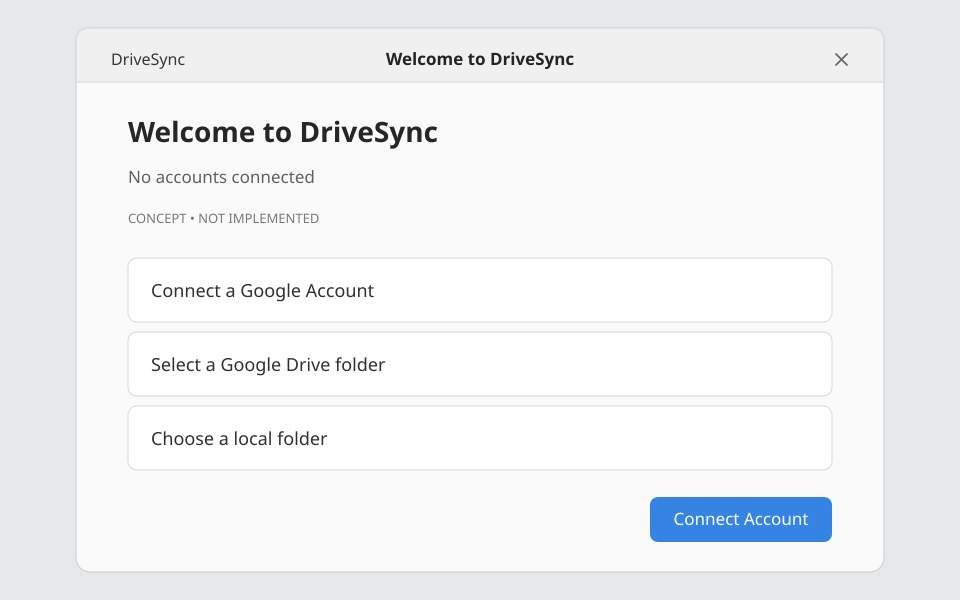
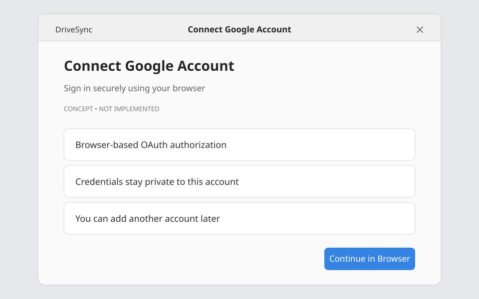
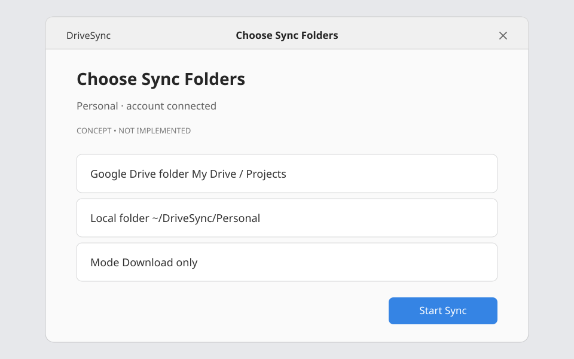
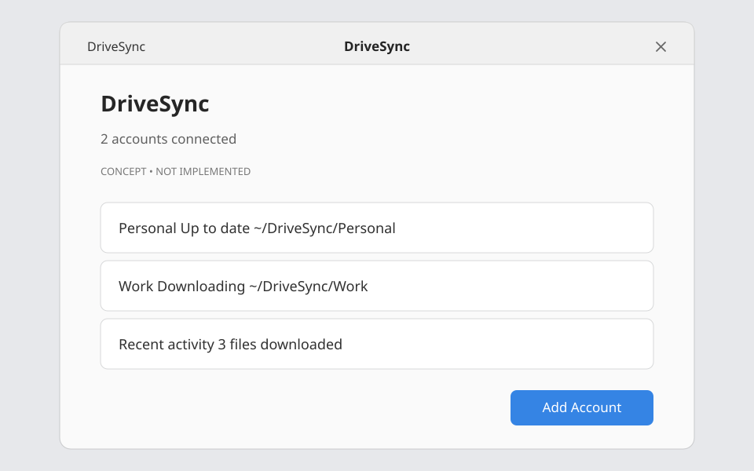
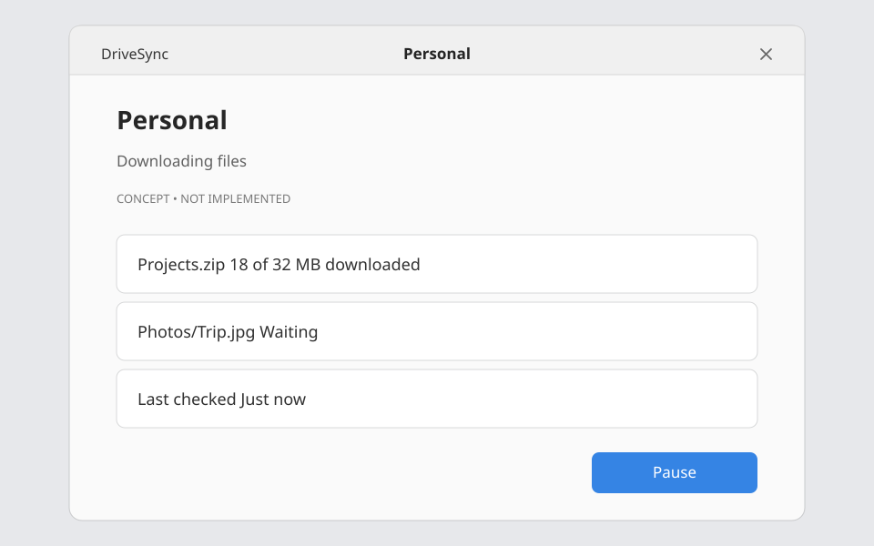
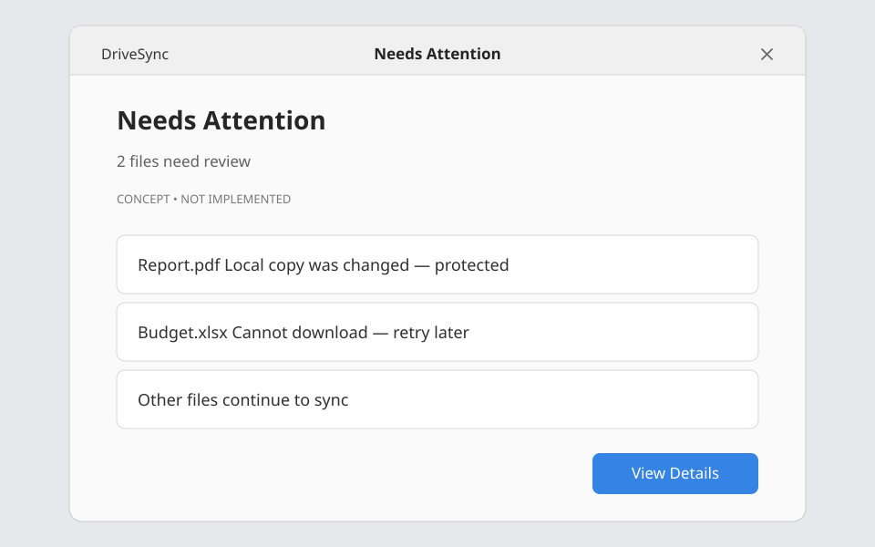
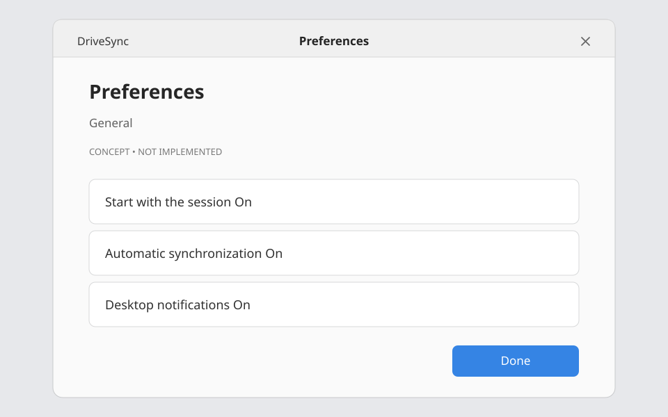
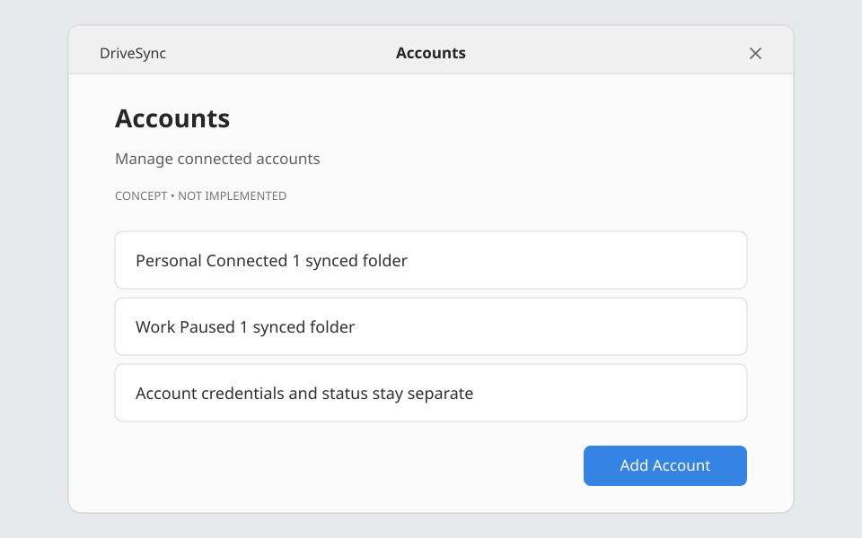

# DriveSync MVP — UI mockups and GNOME HIG review

> **Concept only. No screen shown here is implemented or approved as an exact GTK layout.**
>
> These eight lightweight SVG **wireframes** are published with the repository as the current inspectable UX baseline. The richer visual explorations were produced separately; the vector wireframes are intentionally simplified, not copies of those images. No original generated PNG was uploaded in this commit.
>
> User-facing UI labels are in English. This technical review is in Portuguese.

## Gallery

| Screen | Preview | MVP scope |
|---|---|---|
| First launch |  | Yes |
| Connect Google account |  | Yes |
| Choose a remote and local folder |  | Yes |
| Multi-account overview |  | Yes |
| Account details and transfers |  | Yes |
| Files needing attention |  | Limited |
| Preferences |  | Yes, limited |
| Connected accounts |  | Yes |

## GNOME HIG evaluation

**Verdict: conceptually compatible, NOT pixel-perfect GNOME HIG compliance.** The original rich visual mockups reproduce many familiar GNOME ideas, but use dashboard-like cards, extra top-bar controls and some nonstandard widget compositions. The published SVG wireframes simplify those decisions and are **guidance**, not a UI specification that can be copied pixel by pixel.

| Element in visuals | GNOME/GTK4/Libadwaita counterpart | Review and changes required |
|---|---|---|
| App header, back navigation, menu | `AdwHeaderBar` + `AdwToolbarView`, `AdwNavigationView` | Keep a **few** contextual actions; header icon+app-name+center title and multiple blue buttons are redundant. Tooltips for header controls. On GNOME, use native window decorations, not custom minimize/maximize mock controls. |
| First-run welcome graphic | `AdwStatusPage` and optional illustration | Appropriate as an empty first-run state. Make copy explicitly say **download-only** for the MVP. |
| Account rows/cards | `AdwPreferencesGroup`, `AdwActionRow`, `GtkListView` | Native rows preferred to heavily bordered business-dashboard cards. Use secondary labels and end widgets/actions sparingly. |
| Folder chooser | `GtkFileDialog` / document portal where appropriate; remote selection uses app-managed folder browser | Google Drive remote folder picker has **no ready-made GNOME widget**; compose `AdwNavigationView` + list rows with remote API. Local picker must honor Flatpak permissions. |
| Switches/preferences | `AdwPreferencesDialog`, `AdwPreferencesPage`, `AdwPreferencesGroup`, `AdwSwitchRow`, `AdwComboRow` | Original four-section sidebar could be oversized for a few preferences. Prefer grouped scrolling pages; keep *start with session* as a global setting, not per account. |
| Progress indicators | `GtkProgressBar`, `GtkSpinner` | Do **not** show 100% progress bars for idle, fully synced accounts; show status text/icon. Show percentage only for measurable active work; progress should not mix file-count completion with transferred bytes. |
| Persistent warnings | `AdwBanner` | Use for important persistent problems; green “all okay” banner is unnecessary and overly prominent. |
| Short confirmations | `AdwToastOverlay` | Use for momentary feedback only; don't hide persistent errors in toasts. |
| Destructive choices | `AdwAlertDialog` / guarded action | **Keep Remote / Keep Local / Keep Both are not functional MVP commands**. First iteration lists blocked items and leaves local data untouched. Future conflict actions require before-write version revalidation and safe preservation. |
| Search, help and action overflow | `GtkSearchBar`, `GMenuModel`, menu buttons | Only include if an actual interaction exists. Header search on onboarding is unnecessary; frequent “Add Account” buttons repeated on all views are excessive. |
| Layout resizing | `AdwBreakpoint`, `AdwNavigationSplitView` where needed | Original wide two/three-column screens must collapse gracefully for smaller desktop windows; don't use fixed huge minimum size. |

### HIG references
- [GNOME HIG: Header Bars](https://developer.gnome.org/hig/patterns/containers/header-bars.html)
- [GNOME HIG: Navigation](https://developer.gnome.org/hig/guidelines/navigation.html)
- [GNOME HIG: Buttons](https://developer.gnome.org/hig/patterns/controls/buttons.html)
- [GNOME HIG: Banners](https://developer.gnome.org/hig/patterns/feedback/banners.html)
- [GNOME HIG: Progress Bars](https://developer.gnome.org/hig/patterns/feedback/progress-bars.html)
- [GNOME HIG: Placeholder Pages](https://developer.gnome.org/hig/patterns/feedback/placeholders.html)
- [GNOME HIG: Toasts](https://developer.gnome.org/hig/patterns/feedback/toasts.html)
- [Libadwaita: Adaptive Layouts](https://github.com/GNOME/libadwaita/blob/main/doc/adaptive-layouts.md)

## Functional feasibility against the current engine design

**Key:** CONTRACT = a concept documented in `docs/public-engine-api.md`/module specifications, not implemented Rust. REQUIRES = missing behavior to specify/build.

| Screen | User action/state | Engine provider and prerequisite | Feasibility in MVP |
|---|---|---|---|
| Welcome | First launch with no accounts | `accounts.list` through `DriveSyncEngine.list_accounts`, persistent config | **Compatible**, implementation required |
| Connect | Add account/browser authorization | `auth` + `accounts` OAuth/PKCE, permissions, secret storage, callback | **Compatible but OAuth/scope gate F04 is unresolved** |
| Folder setup | Choose remote folder | `remote` + `accounts`; read existing remote IDs; UI remote browser needed | **Compatible**, remote chooser is custom work |
| Folder setup | Choose local folder | `local` + `configuration`, Flatpak portal and disjoint-root validation | **Compatible**; sandbox permission validation required |
| Dashboard | List 2+ accounts with statuses | `accounts`, `state`, `coordinator`, `notifications`; facade `get_overall_status`, account status | **Compatible**, aggregation must not hide errors |
| Dashboard | Pause/Resume a single account | `coordinator` + `queue`, facade pause/resume per account | **Compatible**, must isolate per-account operations |
| Account detail | Active transfers, progress, history | `queue`, `state`, `notifications`; **REQUIRES** paginated transfer/activity snapshot methods | **Not fully specified**; add read-only contracts before UI |
| Needs attention | Show conflicts and errors | `conflicts`, `state`, `notifications`; `list_conflicts` and **REQUIRES** list actionable issues | **Compatible**, read-only for MVP |
| Needs attention | Keep Local/Remote/Both | `conflicts`, safe snapshot/overwrite policies, future upload | **Out of MVP**; do not present active action buttons in v0.1 |
| Preferences | Start with session | `configuration` + Flatpak Background Portal authorization | **Feasible with constraints**; don't promise authorization |
| Preferences | Close to background | `GApplication` lifecycle and `coordinator` | **Compatible**; MVP close always hides and explicit Quit exits |
| Preferences | Sync interval | `changes` + `coordinator` | **REQUIRES** interval policy / scheduler; avoid a hardcoded five-minute claim |
| Accounts | Connect/disconnect | `accounts` + `auth` | **Compatible**; disconnect cannot delete local content |
| All | Open local folder | GIO/Gtk URI launching; portal where necessary | **Compatible**, desktop integration validation required |
| All | “Synced” status | `state`/Coordinator verified state | **Requires invariant checks**; no “synced” when unknown, ignored or degraded |

### Important corrections to the original high-fidelity examples

1. Mockup images containing `.gdoc` downloads may be misleading; native Google Workspace documents are **out of MVP**. Use regular `.pdf`, `.txt`, `.jpg` or `.zip` in demonstrations.
2. The original Google sign-in screen says uploads happen automatically. **False for MVP**: only downloads from Drive to Linux are in scope.
3. The original conflicts image suggests Keep Local/Keep Remote/Keep Both work. **False for MVP**: show a safe blocked state, not active resolution actions.
4. The original Accounts image advertises 2 or 3 sync folders per account. MVP tests **one sync root per account** and **at least two separate accounts**.
5. A visible `100%` account progress bar while idle should be replaced by an “Up to date” status, not a fictitious completion metric.
6. No GNOME tray is required; the app uses an explicit background-lifetime policy, not an independent daemon.

## Revised MVP UI information architecture

- **Initial state**: Welcome → Browser Authorization → Choose Remote Folder → Choose Local Folder → Start (download-only).
- **Daily use**: Overview (all accounts) → Account Details (status, transfers, activity).
- **Exceptions**: Needs Attention (read-only issues/conflicts; explanatory actions only).
- **Management**: Accounts (add/pause/disconnect) and Preferences (autostart, notifications, automatic checking).
- **Background**: Close window hides, reactivation shows same window, Quit stops the process safely.

## Engine contract gaps to resolve before implementing visuals

1. `list_transfers(account_id, root_id, pagination)` → IDs, progress counts, states.
2. `list_recent_activity(account_id?, pagination)` → timestamped events, no secrets.
3. `list_attention_items(account_id?, pagination)` → conflicts, inaccessible and unsupported items, safe reason/status.
4. `list_remote_folders(account_id, parent_remote_id, pagination)` → navigation without assuming uniqueness of names.
5. `get_sync_preferences(account_id?)`/`set_sync_preferences(...)` → validate scope/global vs per-account.
6. `check_now(root_id)` → explicit scheduling semantics, no duplicate cycle.
7. Account/root summary DTOs contain separate status, last completed sync time, pending/error/ignored counts; no invented percentage when unknown.

These are **proposed read/query commands**, not a claim of implemented functions. The core facade remains the only GUI entry to the engine. For every new contract: source, pre/postconditions, errors, validation and tests under the owning module.

## Deliverables and decision

The eight SVG mockups are **conceptual wireframes committed to the repository**. They preserve all MVP flows without claiming to be generated by GNOME or composed of native widgets. The visual direction is acceptable for an **Adwaita-based implementation after the corrections above**. Actual GTK fidelity, keyboard navigation, focus order, adaptive width and accessibility require a running GNOME Builder prototype and human evaluation. The repository contains **no implemented UI flow** beyond its initial window.
