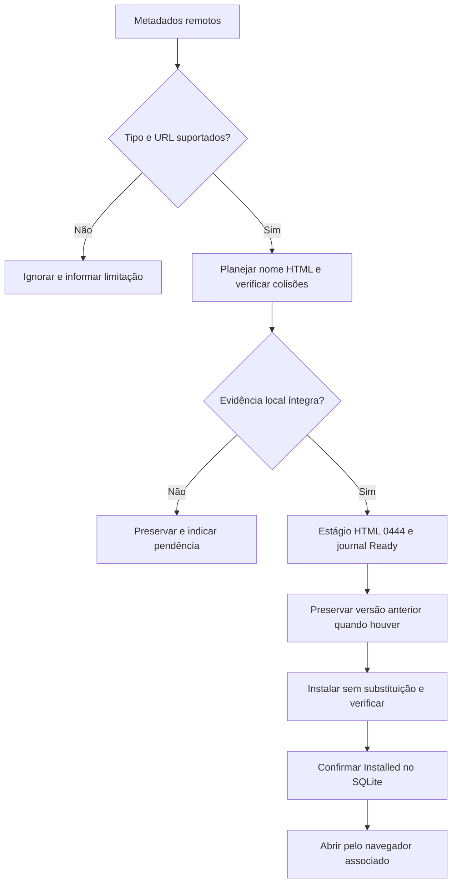

# Workspace: atalhos HTML gerenciados (C24)

## Contrato

Requisitos: [especificação §4.11](../../../docs/SOFTWARE_SPECIFICATION.md#411-documentos-nativos-do-google-workspace).
O inventário distingue Docs/Sheets/Slides (e atalhos Drive para esses tipos) de
binários e tipos não suportados. Nunca usar `alt=media` para documentos nativos.
URLs insuficientes/inseguras não autorizam materialização. Sufixo `.html` participa
da mesma análise de nomes portáveis e colisões dos binários.

O journal `downloads` existente registra `InventoryEntry`, caminho, raiz/pai,
inode/hash e fases Ready/UpdateReady/Installed. Isso não cria uma base binária B.
O lock da raiz serializa workers; não protege contra editores externos.
Os antigos arquivos de planejamento em `docs/old/` são históricos; o formato
vigente é somente HTML, sem detecção ou migração de atalhos anteriores.

## Algoritmo determinístico

1. Validar tipo, nome e URL; revalidar metadados remotos e cadeia de pais.
2. Ler operações do mesmo ID no escopo. Retomar Ready/UpdateReady usando somente
   seus inodes/bytes registrados. Nunca interpretar observação como instalação.
3. Verificar inode, bytes, modo `0444`, raiz e pai da última instalação. Ausência,
   edição, substituição ou renomeação local bloqueiam o item, preservando dados.
4. Se conteúdo/caminho coincidem, retornar sem escrita. Se caminho mudou, exigir
   destino ausente e preservar o anterior. Se URL/título mudou no mesmo caminho,
   preparar atualização com identidade/hash anterior e nome exclusivo de backup.
5. Criar estágio exclusivo, gerar HTML com escaping, aplicar `0444`, fsync do
   arquivo e diretório. Persistir Ready ou UpdateReady antes de publicar.
6. Revalidar estágio/raiz/pai. Na atualização, verificar e mover a versão anterior
   para backup sem substituir destino; verificar o backup antes de prosseguir.
7. Instalar por rename sem substituição, verificar inode/bytes/modo e sincronizar
   diretório. Persistir Installed. Falha de confirmação mantém Ready para replay.
8. Em colisão, cancelamento ou falha, conservar versões/evidências e reportar o
   erro. Estágios sem Ready após falha de persistência são internos ignorados;
   não são promovidos nem apagados por inferência. Backups ficam preservados.

Caminhos de versões anteriores e suas identidades permanecem no journal, inclusive
quando o documento sai do inventário. O upload exclui essa proveniência e recusa
cópias que contenham o marcador HTML. Nunca interpreta HTML como bytes de edição
Workspace. Não tenta deduzir a origem de uma cópia nova sem marcador ou identidade.
Um retorno remoto a um caminho ocupado por versão anterior exige revisão de
colisão; não substituir automaticamente por igualdade de nome.

## Oráculos de validação

- `download::tests::sync019_acceptance::c24_*`: tipos suportados, HTML/escaping,
  permissões, journal real, idempotência, alterações locais, colisão, offline,
  cancelamento, concorrência, falhas de escrita/SQLite e replay de pontos de corte.
- `remote::inventory::tests::c24_*`: allowlist, URL insuficiente/insegura, atalhos
  Drive e codificação de resource key, sem rede real.
- `upload::tests::c24_*`: cópias/renomeações, proveniência gerenciada mesmo com
  bytes alterados, reabertura do SQLite e transferência de HTML comum independente.
- Teste manual obrigatório para evidência da associação real: instalar build
  Flatpak; sincronizar pasta isolada com Docs/Sheets/Slides de teste; abrir os HTML
  com duplo clique no Nautilus; confirmar navegador e documento esperados, `0444`
  e fallback. Provedor simulado não exercita Nautilus, portal, navegador ou login.
  Anotar ambiente, passos e resultado na #57; não aprovar sem execução.

## Fundamentação e limites

Referências primárias consultadas em 2026-11-01:
[Google Drive: download/export](https://developers.google.com/workspace/drive/api/guides/manage-downloads)
distingue blob de conteúdo Workspace e exportação explícita;
[HTML: refresh](https://html.spec.whatwg.org/multipage/semantics.html#attr-meta-http-equiv-refresh)
e [escaping](https://html.spec.whatwg.org/multipage/syntax.html#syntax-attribute-value)
definem redirecionamento e atributos. Representação HTML, modo `0444`, preservação
de versões e ausência de conversão são políticas DriveSync, não garantias da API.
O proprietário pode modificar permissões e conteúdo; o diretório controla exclusão.
Não há teste simulado que comprove associação ou duplo clique do desktop real.
